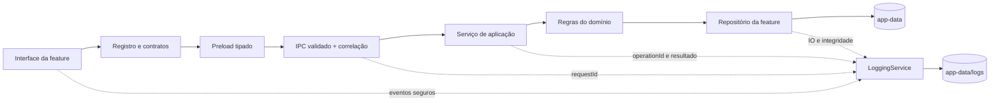

# Plano de estruturação do projeto e dos dados do Gacha Nymi

> **Estado:** plano inicial expandido com arquitetura extensível e logging estruturado. Este documento não moveu código nem dados. O mapa descreve o repositório observado e separa os trabalhos futuros.
>
> **Objetivo do usuário:** manter o código, recursos e todos os dados gerados ou importados pelo app organizados dentro de uma única pasta de projeto, com subpastas claras para personagens, imagens, roteiros, vídeos, fundos, salvamentos e demais dados.

## 1. Resumo executivo

O app já tem uma divisão útil entre interface React, processo principal do Electron, preload e contratos compartilhados. As áreas principais também têm pastas próprias. A maior dificuldade atual é que dois tipos de responsabilidade estão concentrados:

1. `electron/main.ts` mistura inicialização, rotas IPC, validação, arquivos e regras de salvamento de várias áreas.
2. Algumas telas principais concentram milhares de linhas de estado, interface e operações.
3. Os dados persistentes usam `app.getPath('userData')`, que no Windows normalmente resolve para a área AppData do usuário, fora do repositório.
4. Parte das preferências e rascunhos é salva em `localStorage`, separado dos dados gerenciados pelo Electron.
5. Não há um serviço central de logs. A busca atual encontrou `console.error` no Error Boundary, mas não um formato, arquivo, correlação ou tela de logs comuns.
6. A navegação e vários fluxos são registrados diretamente nos componentes. Não há um manifesto único de feature que conecte rota, APIs, dados, capabilities e migrações.

O plano recomenda criar uma raiz interna única para dados, contratos de extensibilidade e logs estruturados. Depois migrar por cópia verificada, mantendo os dados antigos como fallback até a validação. A extração de módulos de código deve acontecer em mudanças pequenas, com testes e builds entre etapas.

**Não é recomendável começar movendo centenas de arquivos de uma vez.** Primeiro estabelecemos caminhos, contratos e validação; depois movemos uma área por vez.

## 2. O que existe hoje

### 2.1 Pastas principais do repositório

```text
GACHA NYMI V5/
├── electron/                 # Processo principal, preload e armazenamento local
├── src/
│   ├── renderer/             # Aplicação React executada no renderer do Electron
│   │   └── src/
│   │       ├── ui/           # App, componentes globais e estilos gerais
│   │       └── features/     # Customizer, Studio, Fabricador, Video Studio etc.
│   └── shared/               # Tipos, validações e regras usadas por mais de uma camada
├── docs/                     # Documentação de áreas e planos existentes
├── scripts/                  # Auditorias e utilitários de desenvolvimento
├── out/                      # Saída compilada pelo Electron Vite (gerada)
├── node_modules/             # Dependências instaladas (geradas)
├── package.json
├── electron.vite.config.ts
└── tsconfig.json
```

`out/` e `node_modules/` já são ignorados pelo Git. Os arquivos de runtime, imagens de usuário e roteiros não devem ser versionados junto do código.

### 2.2 Inicialização, rotas e comunicação

- `src/renderer/src/main.tsx` monta a aplicação React e o roteador.
- `src/renderer/src/ui/App.tsx` define as rotas: `/customizar`, `/estudio`, `/video-studio`, `/opcoes` e `/fabricador-dev`.
- `src/renderer/src/ui/components/` contém elementos compartilhados como barra superior, ícones, previews, retratos e tratamento de erros.
- `electron/main.ts` cria e controla o processo principal e registra handlers IPC de várias áreas.
- `electron/preload.ts` expõe funções específicas e tipadas à interface; o renderer não acessa diretamente Node.js.
- `src/renderer/src/desktop.d.ts` e os tipos em `src/shared/` descrevem as APIs disponíveis.

O fluxo de uma operação persistente costuma ser: página da feature → API tipada `window.desktop` → preload → canal IPC → handler no processo principal → arquivos locais.

### 2.3 Registro e extensibilidade atuais

O Fabricador mantém sua lista de áreas e a seleção de workspace em `FabricatorPage.tsx`; o roteamento fica em `App.tsx`; as APIs são montadas em `preload.ts`; e os handlers IPC ficam em `main.ts`. Ainda não há registro único de módulos que descreva navegação, versão, permissões/capabilities, namespace de dados e migrações.

A base pode receber adições mediante alterações no código, mas não tem um ponto de registro que ajude a fazer essas alterações de forma previsível. O plano propõe módulos internos declarativos e contratos para tipos de conteúdo. Isso não significa executar código arbitrário ou plugins baixados de terceiros.

### 2.4 Áreas do produto e subáreas

| Área | Entrada atual | Módulos/subáreas identificados | Responsabilidade principal |
| --- | --- | --- | --- |
| Customizador | `features/customizer/CustomizerPage.tsx` | forma do corpo, tonalização da pele, resolução de render, efeitos faciais | Compor e personalizar personagens; persistência da biblioteca fica no Electron. |
| Studio normal | `features/studio/StudioPage.tsx` | composição, seleção, transformações, assets e prints | Montar e salvar cenas estáticas independentes do Video Studio. |
| Video Studio | `features/videoStudio/VideoStudioPage.tsx`, `VideoStudioEditor.tsx` | timeline, faixas, transições, preview, fullscreen, áudio, vídeo, biblioteca de fundos, histórico | Editar roteiros temporais e compor vídeos. Já há módulos específicos para diversas operações. |
| Fabricador Dev | `features/fabricator/FabricatorPage.tsx` | Modelos, poses, animações, roupas, olhos/rosto, presets de expressão, animador facial, extras de cabeça, cabelo e design | Criar e manter os assets usados por Customizador e Studios. |
| Opções | `features/options/OptionsPage.tsx` | preferências gerais | Configurações do aplicativo. |
| UI comum | `features` fora das áreas, `ui/components/`, `ui/styles.css` | barra, ícones, previews, retratos, estilos comuns | Elementos reutilizados por mais de uma página. |

Subáreas já separadas no Fabricador incluem `models/`, `wardrobe/` e `face/`. O Video Studio também tem módulos independentes como `VideoTimeline.tsx`, `VideoAudioControls.tsx`, `VideoClipPreview.tsx`, `editHistory.ts`, `characterTransitions.ts`, `transitionRenderer.ts`, `characterGeometry.ts` e `videoMediaPlayback.ts`.

### 2.5 Integrações de dados atuais

As funções abaixo são resolvidas a partir de `app.getPath('userData')`, não de uma pasta interna do repositório:

```text
<Electron userData>/
├── customizer/characters/          # characters.json e dados serializados dos personagens
├── fabricator/
│   ├── models/                      # Slots de modelos, manifests, imagens e histórico
│   ├── poses/                       # Poses e rascunhos por modelo/slot
│   ├── animations/                  # Slots e rascunhos de animação
│   ├── wardrobe/                    # Conjuntos e peças por modelo
│   ├── faces/                       # Sets e catálogo de peças faciais
│   ├── expression-presets/          # Presets, coleções e rascunhos
│   ├── face-components/             # Peças faciais avulsas
│   ├── hair/                        # Workspace e estilos de cabelo
│   └── guides-*.json                # Guias persistentes do Fabricador
└── studios/
    ├── Studio Principal/
    │   └── studio-<id>/              # studio.json, assets e prints
    └── Video Studio/
        ├── studio-<id>/              # studio.json, vídeos, fundos, personagens e frames
        ├── media-library/            # catálogo e arquivos originais de vídeo
        └── background-library/       # catálogo e imagens originais de fundo
```

Os nomes e subpastas acima refletem os caminhos observados no código atual; os formatos internos variam por área. O Studio normal e o Video Studio têm diretórios e documentos separados.

Além disso, há dados no `localStorage` do renderer, por exemplo: seleção do personagem ativo, catálogo legado do Studio, preferências do Fabricador, guias e seleções de rosto e rascunhos de preset de expressão. Esse armazenamento também precisa entrar no inventário de migração. Alguns dados podem ser descartáveis; outros precisam ser preservados.

Arquivos escolhidos em diálogos externos são copiados para a biblioteca do app em vários fluxos. O plano deve preservar essa regra: depois da importação, o app usa a cópia interna e não depende do arquivo original em Downloads, Documentos ou outra pasta.

### 2.6 Logging e diagnóstico atuais

Não foi localizado um logger central, armazenamento estruturado de logs, IDs de correlação, rotação/retenção ou visualizador de logs. O Error Boundary usa `console.error`; os demais fluxos não passam por um serviço comum. Portanto, centralizar logs é uma fundação nova do plano, não uma capacidade já existente.

## 3. Diagnóstico dos módulos

### 3.1 Módulos com escopo amplo

As contagens são aproximações do estado do código consultado para este levantamento; podem mudar com commits posteriores.

| Módulo | Tamanho observado | Diagnóstico | Direção planejada |
| --- | ---: | --- | --- |
| `electron/main.ts` | ~2.300 linhas | Reúne inicialização, caminhos, validação, persistência, migrações e handlers IPC de Customizer, Fabricador e Studios. É o principal acoplamento do processo principal. | Separar bootstrap, IPC por domínio, serviços de domínio e repositórios/armazenamento. Manter `main.ts` como composição e inicialização. |
| `CustomizerPage.tsx` | ~4.000 linhas | Página concentra fluxo visual, composição, edição e estado. Algumas regras já foram extraídas para `bodyShape.ts`, `skinTint.ts`, `renderResolution.ts` e `expressionEffectRender.ts`. | Extrair primeiro componentes/hooks puros com fronteiras claras; manter a composição visual central enquanto cada extração é validada. |
| `VideoStudioEditor.tsx` | ~2.500 linhas | Editor grande, mas já acompanhado por módulos separados para timeline, media, transições, áudio, preview e histórico. | Não reescrever. Completar a separação gradualmente, preservando o modelo de timeline e os módulos já testados. |
| `FabricatorPage.tsx` | ~1.000 linhas | Seleciona áreas e contém também o editor de modelo e operações de canvas/rig. A navegação de áreas está no mesmo arquivo. | Separar o shell/navegação dos workspaces e, depois, extrair canvas/gestos do editor de modelo. |
| `FaceComponentsWorkspace.tsx` | ~1.200 linhas | Reúne subfluxos de olhos, rosto e importação/processamento de folhas. Já existem processadores e workers auxiliares em `face/`. | Separar painéis e fluxos por categoria, mantendo processamento compartilhado em serviços puros/workers. |
| `StudioPage.tsx` | ~1.650 linhas | Página do Studio normal tem edição e persistência visual no mesmo componente. | Separar toolbar, preview, inspector e composição por subcomponentes, sem reutilizar layout com Video Studio. |

O tamanho por si só não prova defeito. O sinal importante é quando uma alteração simples exige tocar várias áreas sem uma interface clara, ou quando UI, regra de negócio e acesso ao disco ficam misturados.

### 3.2 Persistência no processo principal

`electron/main.ts` contém funções de leitura/escrita e validação para várias entidades, além dos handlers IPC. Há stores dedicados para a biblioteca de vídeos e fundos (`electron/videoLibrary.ts` e `electron/backgroundLibrary.ts`), mas muitos outros repositórios permanecem como funções no arquivo principal.

O objetivo é separar armazenamento por domínio, não criar uma camada genérica excessivamente complexa. Cada repositório deve validar seus dados, conhecer seus caminhos relativos à raiz de dados e oferecer operações explícitas de leitura, gravação, lista e remoção.

### 3.3 Estilos e recursos

- `src/renderer/src/ui/styles.css` contém estilos globais e regras de várias telas. Devemos mapear os seletores antes de mover qualquer bloco.
- Algumas áreas já têm folhas próprias, como `VideoStudioEditor.css`, `face-components.css` e `head-extras.css`.
- Imagens de referência e ícones que fazem parte do produto ficam versionados como recursos de código. Isso é diferente de imagens importadas pelo usuário, que pertencem à pasta de dados e não ao Git.
- `scripts/audit-*.mjs` e `scripts/audit-*.cjs` são auditorias do projeto; não há uma pasta `tests/` nem comandos `test` declarados atualmente no `package.json`.

## 4. Estrutura-alvo proposta

Esta é uma proposta inicial, não uma mudança já executada:

```text
Gacha Nymi Workspace/                 # pasta única que o usuário pode mover/guardar
├── electron/
│   ├── bootstrap/                    # ciclo de vida e composição do processo principal
│   ├── ipc/                          # handlers agrupados por domínio
│   ├── features/                     # serviços e repositórios por domínio proprietário
│   └── platform/                     # raiz de dados, logs, backup e diagnóstico
├── src/
│   ├── renderer/src/
│   │   ├── app/                      # rotas, registro validado e navegação
│   │   ├── features/
│   │   │   ├── customizer/
│   │   │   ├── fabricator/{models,poses,wardrobe,face,hair,animation}/
│   │   │   ├── studio/
│   │   │   ├── videoStudio/{timeline,preview,audio,media}/
│   │   │   └── options/
│   │   └── ui/{components,styles}/
│   └── shared/                       # contratos, eventos e regras puras compartilhadas
├── assets/                           # recursos fixos do app, não conteúdo de usuário
├── scripts/{audit,migration,generation}/
├── docs/
├── package.json, electron.vite.config.ts, tsconfig.json, README.md
├── .gitignore
└── app-data/                         # dados privados do usuário; sempre ignorado pelo Git
    ├── characters/
    ├── fabricator/
    │   ├── models/  ├── poses/  ├── animations/  ├── wardrobe/
    │   ├── faces/   ├── expressions/  ├── face-components/  └── hair/
    ├── studios/
    │   ├── normal/<studio-id>/
    │   └── video/<studio-id>/
    ├── libraries/{videos,backgrounds}/
    ├── settings/                     # preferências persistentes e guias
    ├── logs/                          # logs operacionais e trilha de atividade JSONL
    ├── backups/                      # cópias locais de segurança/migração
    └── migration-state/               # marcadores e relatórios, sem assets
```

Na distribuição portátil, a pasta inteira do workspace que contém o executável e `app-data/` deve ser movível em conjunto. O app não deve tentar gravar dentro de `app.asar`, `resources` somente leitura ou de uma pasta de instalação protegida.

**Premissa recomendada para implementação:** em desenvolvimento, a raiz será `app-data/` dentro do próprio repositório. Na versão portátil, a pasta de workspace conterá o executável e `app-data/` juntos. Um único módulo `dataRoot` escolherá e validará a raiz antes de qualquer acesso a dados. O usuário poderá mover a pasta de workspace completa; os caminhos dos assets serão relativos a essa raiz. O plano não grava dentro de `app.asar` nem depende do `%APPDATA%` como destino final.

Na implementação, `src/renderer/src/app/featureRegistry.ts` será a fonte da navegação e dos metadados visuais; módulos de backend declararão serviços, canais IPC e repositórios sob `electron/features/`. Um contrato comum conecta os manifestos, mas a UI não ganha acesso ao disco só por registrar uma tela.

### 4.1 Regras de propriedade das pastas

- `src/`, `electron/`, `assets/`, `docs/` e `scripts/` contêm código, recursos fixos, documentação e ferramentas versionáveis.
- `app-data/` contém personagens, modelos importados, fotos, roteiros, vídeos, imagens de fundo, rascunhos e configurações criados pelo usuário.
- `app-data/` deve estar no `.gitignore`; só poderá ser compartilhada por exportação/backup explícito.
- `out/`, `node_modules/`, caches e arquivos temporários continuam gerados e fora do Git.
- Uma importação deve copiar o arquivo para `app-data/`, verificar a cópia e então referenciar apenas o ID/caminho relativo interno.
- Código da interface não constrói caminhos locais; chama APIs do preload com IDs e documentos tipados.
- Processo principal valida IDs, limites, extensões e caminhos antes de ler/gravar. Nenhuma API IPC recebe uma cadeia de caminho livre sem validação.

### 4.2 Registro extensível de features

Cada área interna deve declarar um manifesto tipado (`FeatureDefinition`) e entrar no app por um registro central validado. O manifesto será a fonte única para identidade, navegação e capacidades; a composição visual continua pertencendo à feature.

Campos recomendados:

| Campo | Uso |
| --- | --- |
| `id` estável | Referência permanente, sem depender do nome exibido ou do caminho do arquivo. |
| `version` e `dataSchemaVersion` | Distinguir versão do código e formato persistido. |
| `label`, `icon`, `route`, `navigationGroup` | Montar menu e rota com validação de colisões. |
| `capabilities` | Declarar uso de personagens, mídia, impressão, backup, logs ou outros serviços. |
| `dataNamespace` | Pasta própria dentro de `app-data/`; um módulo não apaga dados de outro. |
| `commands` e `eventSubscriptions` | Operações IPC permitidas e eventos consumidos. |
| `migrations` | Transformar documentos antigos de forma versionada e recuperável. |
| `healthCheck` | Verificar dependências e disponibilidade do armazenamento quando necessário. |

Estrutura sugerida:

```text
src/renderer/src/app/featureRegistry.ts    # navegação e registro visual
src/renderer/src/features/<feature>/        # interface, hooks e regras da área
electron/features/<feature>/manifest.ts     # declaração backend da feature
electron/features/<feature>/commands.ts    # comandos de aplicação
electron/features/<feature>/repository.ts  # dados e arquivos da feature
electron/ipc/<feature>.ts                  # conexão validada com o preload
```

O registro deve validar IDs repetidos, rotas conflitantes, capabilities inexistentes, versões e dependências antes de ativar módulos. Adicionar ou remover uma feature do produto passa por esse registro, seus contratos e uma migração; telas não ficam registradas em listas paralelas espalhadas.

Fluxo proposto para uma nova feature:

1. Um gerador (`npm run generate:feature -- --id <id>`) cria esqueleto de UI, manifesto, comandos/IPC, repositório, migração inicial, logs e documentação técnica.
2. O desenvolvedor define os contratos e capabilities mínimas; o registro verifica colisões e dependências.
3. Cada novo tipo de conteúdo declara schema, operações suportadas, preview/índice (se necessário) e proprietário do dado.
4. A verificação de módulo confirma build, contratos, logging, migrações e fluxos de criação/importação/edição/remoção.
5. O módulo só aparece na navegação depois de satisfazer o contrato, sem adicionar condições especiais a páginas não relacionadas.

Fluxo para remover uma feature:

1. Desativar criação e navegação para conteúdo novo, sem apagar a pasta de dados.
2. Levantar documentos, assets, eventos e outras features que ainda referenciam o namespace.
3. Oferecer exportação/backup e leitura/restauração dos dados existentes durante a janela de compatibilidade.
4. Migrar referências ou arquivar o namespace; registrar a versão e o resultado.
5. Só remover dados físicos depois de comando explícito, confirmação clara e backup verificável. Retirar código de produção não apaga silenciosamente os dados do usuário.

**Segurança:** o registro cobre módulos do próprio app, compilados e revisados junto ao projeto. Não deve executar plugins arbitrários, scripts de usuário ou código baixado dinamicamente. Uma futura plataforma de plugins externos exigiria sandbox, assinatura, permissões e revisão separada.

### 4.3 Contrato de conteúdo e ciclo de vida

Para permitir novos tipos de conteúdo (peças, poses, imagens, coleções ou mídias), cada feature declara um `ContentTypeDefinition`:

- ID estável e feature proprietária;
- schema e versão;
- validação, limites, formatos e referências;
- operações permitidas: criar, ler, editar, duplicar, importar, exportar, arquivar, restaurar e excluir;
- namespace de armazenamento e comportamento de preview/busca quando aplicável.

As features compartilham o envelope, os comandos e os cuidados de persistência; cada domínio mantém suas próprias regras. Não se deve forçar personagem, pose, vídeo e roupa para dentro de um único documento genérico.

Fluxo padrão para mutações:

1. Validar comando, capability, schema, limites, ID e relações.
2. Gerar um ID estável e preparar documentos/assets temporários dentro da raiz de dados.
3. Verificar gravação, tamanho/hash e referências do manifest antes de publicar o novo estado.
4. Confirmar a operação no repositório e registrar um único resultado de domínio.
5. Remoção normal vai primeiro para lixeira/arquivo recuperável; exclusão permanente e coleta de assets órfãos são comandos separados e explícitos.
6. Restauração valida referências e conflitos antes de reativar o conteúdo.
7. Importação/exportação usa manifest com versão; nomes de arquivo e extensões nunca são validação suficiente.

Eventos de domínio (`character.created`, `asset.updated`, `studio.archived`, `migration.completed`) comunicam mudanças a outras features. Eles carregam IDs e metadados mínimos, não imagens/documentos inteiros. Eventos são para efeitos secundários e integrações; uma operação que depende de retorno imediato chama um serviço diretamente. Arrastes e edições por frame são agregados para não emitir centenas de eventos.

### 4.4 Logging central e estruturado

Será criado um `LoggingService` único. UI, preload, handlers IPC, serviços, repositórios, inicialização e migrações usam o mesmo contrato. Handlers comuns atribuem `requestId`; operações atribuem `operationId`; a resposta/erro e os logs correspondentes compartilham esses IDs.

Formato JSON Lines, um objeto por linha:

```json
{
  "timestamp": "2026-10-18T12:34:56.789Z",
  "level": "info",
  "event": "asset.import.completed",
  "feature": "fabricator.wardrobe",
  "layer": "storage",
  "operationId": "uuid-da-operacao",
  "requestId": "uuid-da-requisicao-ipc",
  "entity": { "type": "wardrobe-piece", "id": "id-estavel" },
  "result": "success",
  "durationMs": 84,
  "details": { "bytes": 125000, "format": "png" }
}
```

Campos recomendados: timestamp UTC, nível (`trace`, `debug`, `info`, `warn`, `error`, `fatal`), event name estável, feature, camada, IDs de correlação, entidade opcional, resultado, duração, código de erro e detalhes aprovados por schema.

Dois fluxos, no mesmo serviço:

1. **Logs operacionais:** inicialização, rotas/IPC, falhas, IO, imports, exports, migrações, backups, restaurações e integridade. Rotacionados por data/tamanho, com retenção configurável.
2. **Trilha de atividade:** criações, edições, arquivamentos, exclusões, restaurações, imports/exports e mudanças importantes. Append-only dentro do período de retenção, com operação e entidade correlacionadas.

Ambos ficam em `app-data/logs/`, com arquivos/esquemas separados. A tela **Opções → Logs** deve filtrar por período, nível, feature e operação; exibir detalhes seguros; exportar um pacote de diagnóstico redigido; e gerenciar retenção/limpeza. Alterar retenção ou limpar logs também gera evento de auditoria.

**Privacidade e volume:** não registrar data URLs, bytes de fotos/vídeos, texto integral de roteiro, tokens, segredos, caminhos absolutos nem nomes pessoais por padrão. Erros são sanitizados. Registrar a ação e o resultado, não cada frame, pixel, mousemove ou atualização da preview. Uma operação composta gera um evento de domínio, com os logs técnicos ligados pelo mesmo `operationId`, sem duplicação de eventos de sucesso. Se o armazenamento de logs falhar, usar fallback limitado em memória/console e notificar; logging não pode impedir o salvamento de um asset.

Fluxo arquitetural resumido:



## 5. Plano de trabalho por etapas

### Etapa 0 — Fechar o inventário e a especificação

- [x] Mapear rotas, áreas, módulos grandes e os principais pontos de persistência.
- [x] Escrever este plano inicial e registrar decisões/itens que exigem validação.
- [ ] Inventariar as chaves restantes de `localStorage`, distinguindo preferências descartáveis de dados que precisam migrar.
- [ ] Documentar formatos de manifest e referências entre JSON e imagens para cada tipo de asset.
- [ ] Definir o contrato `FeatureDefinition`, o registro central e a validação de colisões/dependências.
- [ ] Definir schema de logs, eventos de domínio, retenção, redaction e operação em caso de disco cheio.
- [ ] Mapear comandos de criação/importação/duplicação/arquivo/restauração/exclusão de cada domínio.

**Saída:** mapa de migração com origem, destino, formato e procedimento de recuperação para cada domínio.

### Etapa 1 — Preparar a fundação extensível e observável

- [ ] Adicionar `app-data/` ao `.gitignore` e confirmar que nenhum arquivo do usuário entra no Git.
- [ ] Criar `electron/platform/storage/dataRoot.ts` como única origem dos caminhos. Não espalhar `app.getPath('userData')` por handlers.
- [ ] Criar o registro estático de features e validar IDs, rotas, dependências, capabilities e versões na inicialização.
- [ ] Criar `electron/platform/logging/` com logger JSONL, correlação, sanitização, rotação, retenção e fallback.
- [ ] Instrumentar IPC e comandos de domínio para logar ação, resultado e duração uma vez por operação.
- [ ] Adicionar contrato compartilhado de conteúdo/command e operações recuperáveis sem apagar silenciosamente.
- [ ] Adicionar diagnósticos da raiz efetiva, permissões, espaço disponível e estado dos módulos.
- [ ] Tornar os caminhos dos repositórios relativos à raiz, sem alterar ainda os dados atuais.

**Critério de aceite:** features e APIs aparecem no registro; uma chamada de teste recebe IDs correlacionáveis em renderer, IPC, serviço e armazenamento; os logs não contêm conteúdo privado; o app continua salvando se o serviço de logs falhar; a raiz interna é gravável e não aparece como alteração Git.

### Etapa 2 — Migrar dados com cópia verificável

1. Fechar o app antes de uma migração real e obter o caminho atual através do próprio Electron (`app.getPath('userData')`), sem adivinhar o nome da pasta.
2. Fazer inventário de quantidade e tamanho por domínio e gravar relatório de origem/destino.
3. Copiar para `app-data/` sem apagar nem sobrescrever conflitos. Calcular SHA-256 de cada arquivo copiado e verificar JSON/manifests.
4. Migrar também as preferências necessárias do `localStorage` através de um fluxo temporário controlado pelo renderer e preload.
5. Na primeira versão, ler do destino e usar a origem antiga como fallback somente para arquivos ainda não migrados.
6. Registrar versão/estado da migração e torná-la repetível: reabrir o app não duplica arquivos nem sobrescreve dados mais recentes.
7. Verificar contagens, hashes, referências de assets, abertura de personagens, modelos e os dois tipos de Studio.
8. Manter a origem original intacta por um período de validação. Só remover cópias antigas mediante ação explícita de limpeza e depois de backup verificável.

**Critério de aceite:** dados abrem depois de reiniciar o app; cada referência do documento encontra seu asset; conflitos ficam preservados e relatados; a origem não foi apagada automaticamente.

### Etapa 3 — Extrair persistência e IPC por domínio

- [ ] Extrair `customizer` (personagens) para um repositório/serviço com schema e migrações próprios.
- [ ] Extrair `fabricator` em repositórios de modelos, poses, animações, roupas, rosto, cabelo e presets, agrupados pelo ciclo de vida real dos dados.
- [ ] Extrair `studio` e `video-studio` mantendo APIs, layouts, pastas e documentos independentes.
- [ ] Extrair handlers em `electron/ipc/<domínio>.ts`; `main.ts` fica responsável por iniciar módulos e compor dependências.
- [ ] Manter canais IPC pequenos, tipados e validados no processo principal.
- [ ] Criar migrações de schema versionadas e testáveis para documentos que evoluem.
- [ ] Emitir eventos de domínio após commit bem-sucedido; consumidores devem ser idempotentes e declarar dependências.
- [ ] Implementar lixeira/arquivo e restauração antes de habilitar exclusão permanente genérica.

**Critério de aceite:** cada handler pertence a um domínio claro; os imports entre áreas não criam ciclos; o preload continua expondo apenas APIs necessárias.

### Etapa 4 — Organizar as features do renderer

- [ ] Extrair rotas e shell geral para `renderer/src/app/`.
- [ ] Organizar cada feature pelas responsabilidades existentes: página/composição, componentes, hooks, serviços puros e estilos próprios.
- [ ] Começar por telas grandes usando extrações pequenas sem alterar comportamento ou layout.
- [ ] Mover CSS global para estilos de feature apenas após confirmar quem usa cada seletor.
- [ ] Preservar helpers existentes e evitar duplicar composição facial, timeline, renderização ou transformações.
- [ ] Manter `shared/` pequeno: código só vai para lá quando houver mais de um consumidor e contrato estável.

**Critério de aceite:** as rotas visuais se comportam como antes; Studio normal e Video Studio permanecem independentes; componentes de feature não importam arquivos privados de outra feature.

### Etapa 5 — Ferramentas operacionais e validação final

- [ ] Continuar executando `npm run typecheck` e `npm run build` a cada mudança estrutural.
- [ ] Organizar auditorias existentes em subpastas por domínio e documentar pré-requisitos/saídas.
- [ ] Adicionar testes de migração e persistência que usem pastas temporárias de teste, nunca os dados reais do usuário.
- [ ] Adicionar teste de inicialização e teste de IPC por domínio.
- [ ] Criar a tela Opções → Logs com filtros, detalhes redigidos, exportação e retenção.
- [ ] Criar pacote de diagnóstico exportável sem conteúdo privado nem arquivos de usuário.
- [ ] Validar criação, edição, importação, exportação, arquivamento, restauração e remoção em cada domínio.
- [ ] Executar os fluxos de abertura, gravação, reinicialização e recuperação para cada tipo de dados.
- [ ] Fazer busca final por caminhos antigos, chaves legacy, dependências circulares e handlers órfãos.
- [ ] Manter backup até a aprovação da verificação dos dados migrados.

## 6. Riscos e proteções

| Risco | Proteção planejada |
| --- | --- |
| Instalação em diretório sem permissão de escrita | Distribuição portátil dentro de uma pasta gravável; nunca salvar em `app.asar`. Verificar permissões ao iniciar e explicar o caminho. |
| Perda ou sobrescrita de fotos e roteiros | Copiar antes de trocar caminhos; validar tamanho/hash; não apagar origem automaticamente; gerar relatório por domínio. |
| Catálogo JSON e arquivos perderem sincronia | Validar referências após a cópia e usar migrações idempotentes. Não reconstruir manifests silenciosamente. |
| Caminhos absolutos quebrarem ao mover a pasta | Salvar referências relativas à raiz de dados e IDs; resolver caminhos somente no processo principal. |
| Commit acidental de dados privados | Ignorar `app-data/`, adicionar verificação de arquivos grandes/sensíveis e revisar `git status` antes de commit. |
| Refatoração mudar a interface ou fluxo de edição | Separar primeiro sem alterar comportamento; comparar os dois Studios e validar cada feature após cada extração. |
| `localStorage` ficar para trás | Inventariar as chaves, classificar importância e migrar com uma versão de compatibilidade antes de remover leituras antigas. |
| `main.ts` continuar crescendo depois da divisão | Política simples: novo domínio entra em seu módulo IPC/repository; `main.ts` apenas compõe dependências. |
| Uma nova feature ficar registrada em apenas um dos processos | Validar FeatureDefinition no boot e manter registro da UI e do Electron correlacionados por ID/versão. |
| Tipo novo causar esquema genérico frágil | Compartilhar o ciclo de vida/envelope, mantendo schema e regras pertencentes ao domínio. |
| Falha ou volume excessivo de logs prejudicar o app | Rotacionar, limitar retenção, agregar gestos e nunca bloquear gravações por falha do logger. |
| Logs vazarem informação pessoal ou conteúdo de mídia | Allowlist de campos, sanitização de erros e redaction testada; proibir payloads e data URLs. |
| Remoção de área deixar dados órfãos ou destruir referências | Arquivar/ocultar feature sem apagar namespace; remoção física requer relatório de dependências e ação explícita. |
| Evento de domínio ser processado duas vezes | `eventId`/`operationId`, schema versionado e consumidores idempotentes. |

## 7. Convenções de arquitetura propostas

1. **Uma fonte de verdade por tipo de dado.** Ex.: o personagem é salvo no repositório de personagens, não em estado duplicado no renderer e em outro catálogo paralelo.
2. **As features possuem o próprio fluxo.** Uma tela de Studio não importa o editor privado de Video Studio.
3. **Contratos atravessam camadas; implementações não.** `shared/` define tipos/validações puras; renderer não importa módulo de disco do Electron.
4. **Acesso a arquivos tem dono.** Cada repositório recebe `dataRoot` e usa caminhos internos; componentes React não conhecem a estrutura do disco.
5. **Dados do usuário não são assets de build.** Fotos, projetos e roteiros vão para `app-data/`; ícones e imagens fixas vão para `assets/`.
6. **Mudanças de schema têm versão e migração.** Não depender de reparo implícito espalhado por telas.
7. **Refatoração é incremental e observável.** Cada etapa deve ser revisável, compilável e recuperável.
8. **Features são registradas, não espalhadas.** IDs e contratos estáveis; labels traduzíveis; dependências e capabilities declaradas.
9. **Remoção não significa destruição de dados.** Primeiro arquivar/desativar, depois oferecer exportação e só então limpar mediante ação clara.
10. **Logs descrevem operações, não conteúdo privado.** Todo comando importante é rastreável por IDs, mas nunca precisa registrar os bytes ou o texto que o usuário editou.
11. **Falhas têm código estável e contexto.** A UI mostra uma mensagem compreensível; o log guarda detalhes sanitizados e a cadeia de correlação.
12. **Não usar um sistema de plugins irrestrito como atalho.** Extensibilidade segura começa por módulos internos declarados e APIs versionadas.

## 8. Pontos em aberto para a próxima etapa

Este documento registra o plano inicial; estes detalhes precisam ser definidos durante a implementação, antes de mudar o armazenamento:

- Quais valores de `localStorage` são simples preferências e quais são dados essenciais recuperáveis?
- Quais imagens de personagem estão embutidas em JSON e quais estão em arquivos separados?
- Como oferecer exportação/backup manual da pasta `app-data/` para outro computador sem misturar isso com commits Git?
- Como a distribuição será portátil, o pacote final deverá manter `app-data/` junto do executável em uma pasta gravável; não será usado o instalador padrão como destino de dados.
- Qual retenção inicial atende o uso local dos logs, mantendo um limite de espaço e opção de exportar antes da limpeza?
- Quais operações precisam de trilha de auditoria permanente e quais só exigem log operacional rotacionado?
- Quais capabilities de backend serão oferecidas na primeira versão do registro, e quais dados podem ser referenciados por mais de uma feature?

## 9. Referências do repositório

- `README.md` — comandos de desenvolvimento, build e separação atual das camadas.
- `docs/STUDIO_WORKSPACES.md` — independência entre Studio normal e Video Studio, biblioteca de vídeos/fundos e persistência atual.
- `electron.vite.config.ts` — bundles separados para main, preload e renderer.
- `electron/main.ts` — caminhos, persistência e handlers atuais; principal candidato à extração gradual.
- `electron/preload.ts` — fronteira segura de APIs entre renderer e Electron.
- `electron/videoLibrary.ts` e `electron/backgroundLibrary.ts` — exemplos atuais de stores locais separados.
- `src/renderer/src/ui/components/AppErrorBoundary.tsx` — Error Boundary atual; candidato a emitir erros por logging central.
- `src/shared/` — contratos e regras compartilhadas atuais.
- `src/renderer/src/features/` — páginas e subáreas do produto.
- `scripts/audit-*.mjs` e `scripts/audit-*.cjs` — auditorias atuais, várias dependem de build compilado e/ou arquivos de mídia de teste.

