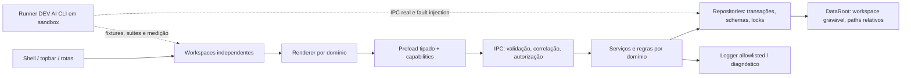

# Plano de refatoração integral — Gacha Nymi (G-V5)

> **Estado em 2026-10-18:** plano revisado a partir de inspeção estática de código, dependências, árvore e histórico do commit `5b8483454757f4cc9606c626471aabbeccf35daa`. **Nenhuma refatoração de runtime ou migração foi realizada nesta revisão.** Não confundir uma proposta de arquitetura com uma funcionalidade disponível ou um teste aprovado.
>
> **Atualização de execução em 2026-10-19:** o registro estático acima é histórico. Depois dele, o [PR #3](https://github.com/nestarasup-sys/G-V5/pull/3) integrou a fundação DEV AI, IPC Electron real e correções de roupa/pose à `master` (`3b70ceef`). A branch de trabalho é `master-desenvolvimento`. **Roupas Dev é uma área única sobre a folha original**, preservando leitura de edições legadas. O usuário reportou um teste positivo de ajustes acompanhando poses e Studios; as matrizes AF/ISO e migração continuam abertas. Ver [Entrega A](refactor/AUDITORIAS/ENTREGA_A_CI_E_ROADMAP_2026-10-19.md).
>
> **Objetivo de produto:** melhorar velocidade, consumo de recursos, confiabilidade, segurança, manutenção, portabilidade, extensibilidade e experiência de uso; não simplesmente reduzir linhas ou reorganizar pastas. Preservar os dados do usuário e impedir regressões, principalmente entre Studio normal e Video Studio.
>
> **Fonte de verdade por assunto:** consulte [docs/refactor/README.md](refactor/README.md). O [inventário com evidências](refactor/INVENTARIO_E_EVIDENCIAS.md) registra fatos e incertezas; o [roadmap executável](refactor/ROADMAP_EXECUTAVEL.md) é a **única fonte de verdade dos checklists de implementação e validação**. Este documento define objetivos, políticas e gates comuns. A versão extensa anterior permanece no histórico Git em [`5b848345`](https://github.com/nestarasup-sys/G-V5/blob/5b8483454757f4cc9606c626471aabbeccf35daa/docs/PLANO_ESTRUTURA_PROJETO_E_DADOS.md) e está **superada** como plano operacional, não apagada da história.

## 1. Resultado esperado

Uma pessoa deve conseguir instalar e atualizar o G-V5, criar e editar personagens/cenas/roteiros/mídia, alternar workspaces, salvar, exportar, fazer backup, restaurar, mover a pasta dos projetos e recuperar-se de erros **sem perder conteúdo nem ter uma área afetada acidentalmente por outra**.

**Gates de produto:**

- **Integridade/recuperação:** cópia e backup verificável antes de migrar ou excluir; manifest+assets consistentes após falhas; import/export com checksums; exclusão normal recuperável; instalação/atualização não destrói workspace.
- **Isolamento:** topbar é navegação/shell, não uma store global de editores; workspaces possuem documento, seleção, histórico, atalhos, CSS, handlers, timers, mídia, cache e lifecycle próprios. Compartilhamento deliberado de personagens/poses/assets usa contrato explícito.
- **Responsividade:** estabelecer baseline reproduzível de startup, navegação, primeiro preview, timeline, drag/seek, importação, save e pico de memória/CPU, com dados sintéticos pequenos/médios/grandes, N ≥ 20, p50/p95 e ambiente registrado. Otimizações só são aprovadas se superarem o ruído sem alterar saída funcional/visual.
- **Segurança:** renderer com APIs IPC estreitas; entradas importadas não confiáveis; caminhos relativos e canônicos; permissões/URLs/protocolos explícitos; cadeia de suprimentos controlada; nenhum upload de arquivos privados, código, logs ou mídia por padrão.
- **Qualidade/uso:** navegação, foco/teclado, modais, erros claros, status real de salvamento, acessibilidade, estados de loading/retry/cancel, regressão visual e automação offscreen, inclusive áreas não modificadas após mudanças transversais.
- **Evolução:** registrar modules/features internas com IDs e contratos estáveis, sem execução de plugins arbitrários. A fonte única da identidade/capabilities deve manter compatibilidade de schema e dar rastreabilidade às migrações.

## 2. Situação comprovada e correções do plano anterior

A inspeção foi feita sobre a **branch `master`** do repositório, não sobre uma instalação em produção. A árvore recursiva retornou 128 entradas sem truncamento. O diagnóstico detalhado e os pontos não comprovados estão classificados na [matriz E-01–E-28](refactor/INVENTARIO_E_EVIDENCIAS.md).

| Situação | Classificação | Consequência no plano |
| --- | --- | --- |
| React + Electron + preload tipado + cinco rotas, arquivos de Studios separados | **Confirmado** | Manter fronteiras existentes e fortalecer contratos, não reescrever tudo |
| `electron/main.ts` com 2.300 linhas e 75 registros `ipcMain.handle` | **Confirmado** | Extrair serviços de armazenamento e IPC incrementalmente com testes |
| `ui/App.tsx` recebe sinal `onEditorActiveChange` do Video Studio para esconder a topbar | **Confirmado** | Isolar política do shell; esse é um acoplamento concreto a remover |
| Há scripts de auditoria, incluindo `audit-studio-isolation.cjs`, mas não `npm test`/runner geral | **Incompleto no texto anterior** | Reutilizar auditorias existentes; ampliar para IPC real, estado, lifecycle, CSS e performance |
| `VideoStudioEditor.tsx` importa `../studio/expressionTransforms`; Customizer importa componentes/helpers privados do Fabricador | **Confirmado** | Classificar shared puro versus dependência indevida; impedir import de editor/estado privado |
| Persistência deriva de `userData` e existem preferências/rascunhos em `localStorage` | **Confirmado** | Migrar só por cópia e inventário de todas as chaves; preservar legado |
| Algumas escritas publicam manifest via `rename`, mas assets são gravados antes; existem `rm`/`unlink` | **Confirmado** | Criar transação/journal, restore e lixeira **antes** de mover diretórios |
| `VideoLibraryStore` verifica tamanho das cópias, não SHA-256 | **Confirmado** | Verificação de conteúdo por hash nos fluxos de migração e integridade |
| `docs/STUDIO_WORKSPACES.md` citado no plano original foi removido pelo commit `192245e` | **Desatualizado** | Não recriar referência quebrada; preservar contexto no inventário/histórico |
| Falha histórica entre Studios teve commit de correção `e352f04` | **Confirmado no histórico** | Tratar como regressão obrigatória, **não** inferir que está resolvida hoje |
| CSP, restrições de navegação, desempenho real, exposição a payloads maliciosos | **Investigação necessária** | Construir testes e baseline; leitura de código não equivale a certificação |
| Suítes, compilação, benchmarks e inspeção de UI nesta revisão documental | **Não comprovado / não executado** | Manter checklists abertos e não atribuir ganhos |

## 3. Arquitetura-alvo por fronteiras, sem big bang

**Separações obrigatórias:** `electron/bootstrap/` compõe app e lifecycle; `electron/ipc/` valida comandos; `electron/features/<domínio>/` guarda regras e repositórios de cada área; `electron/platform/` fornece raiz de dados, logging, backup/diagnóstico. `src/renderer/src/app/` define navegação e contrato dos workspaces; `src/renderer/src/features/` possui tela, hooks, estado, estilos próprios; `src/shared/` mantém tipos/validações puras consumidas por mais de uma área. **São destinos propostos, não pastas já existentes.**

Organizar por capacidade e propriedade de dados, não somente por nomenclatura de UI. Contratos entre renderer/preload/main precisam de versão e verificação de compatibilidade; main resolve caminhos e não confia em pastas arbitrárias vindas do renderer. Adotar `WorkspaceLifecycle` para cancelar tasks, listeners, RAF, playback e mídia ao sair sem perder gravação durável já confirmada na fila do main. Não criar um sistema de plugins externos irrestritos como atalho.

Mudanças de CSS começam pelo mapeamento de seletores e screenshots baseline de ambas as áreas; só então escolher CSS Modules/root-scoping. Conservar componentes/renderizadores comuns quando são **puros**, mas não deixar shared visual controlar layouts privados. A topbar declara a navegação; preferências e status de gravação só podem mostrar estado real, não texto estático enganoso.

## 4. Dados realmente portáteis, integridade e recuperação

A meta é uma pasta movível que guarda **todos os dados e recursos gerados/importados pelo usuário**; isto **não significa gravar no diretório de instalação**, que pode ser somente leitura. O produto deve oferecer escolha de workspace gravável. Separar arquivos executáveis e assets fixos da biblioteca privada do usuário; ignorar `app-data/` no Git antes de criá-la. Usar referências por ID/caminhos relativos, propriedade explícita de cada domínio/projeto e namespaces independentes `studio`/`video-studio`.

O layout-alvo e a atribuição de ownership de personagens/Fabricador/bibliotecas só serão fechados após inventário de fluxos reais. O mapeamento legado proposto, estado de migração, transações, restauração, lixeira e pacote exportável estão em [DADOS_E_RECUPERACAO.md](refactor/DADOS_E_RECUPERACAO.md).

**Sem exceções:** antes de qualquer exclusão/mudança de root, inventariar dados, congelar gravação, fazer snapshot verificável/restaurável, calcular hashes de cada arquivo, copiar para staging, validar manifests, referências e conflitos, publicar operação idempotente, manter origem intocada até aprovação e permitir recuperação. Nunca adivinhar caminho `%APPDATA%`, jamais sobrescrever conflitos silenciosamente. Testar falhas simuladas em sandbox; nenhuma migração real ocorreu nesta revisão.

## 5. Independência entre Studio normal e Video Studio

O incidente reportado no passado torna obrigatória a regressão **Studio → Video Studio → Studio**. A presença de páginas e pastas separadas **não prova** isolamento completo. Os 15 cenários `ISO-01–ISO-15`, contratos, observáveis e matriz de impacto estão em [ISOLAMENTO_STUDIOS_E_DEV_AI.md](refactor/ISOLAMENTO_STUDIOS_E_DEV_AI.md).

**Critério de aceite:** mudanças em vídeo não alteram computed styles, painel/canvas, seleção, histórico, shortcuts, comportamento de salvar, estado persistido e recursos ativos do Studio normal; o inverso também vale. A suíte testa com fake preload (visual rápida) **e com Electron/preload/IPC real em sandbox**. O backend rejeita workspace inválido, inclusive documento com mesmo formato/ID. Suítes de regressão abrangem Customizer/Fabricador/Opções quando código compartilhado ou shell for alterado.

## 5.1. Fluxo obrigatório de autoria dos assets, roupas e personagens

**Regra de produto solicitada:** [contrato integral do fluxo Fabricador Dev → Customizador → Studio/Video Studio](refactor/FLUXO_ASSETS_FABRICADOR_CUSTOMIZADOR_STUDIOS.md) é **normativo** para qualquer mudança de modelo, pose, roupa, sapato, cabelo, óculos, acessórios, rosto e renderizador.

**Ordem de autoria:** `Fabricador Dev / Modelos` define a folha desmontada e guarda o modelo montado, pivôs, juntas, IDs e `sourceTransform` de cada parte. `Poses Dev` parte desse modelo montado para criar poses reutilizáveis, com pose 1 preferida como default, sem modificar o original. `Roupas Dev` e `Roupas Dev 2.0` encaixam cada roupa/sapato **nas peças da folha desmontada**, salvando coordenadas em referencial local do osso e exibindo teste na pose montada. O 2.0 só usa sua referência especial em modelos compatíveis, com identidade e versão da folha verificadas. `Cabelos Dev` e `Cabeças Extra` usam a **cabeça isolada** para calibrar respectivamente camadas de cabelo e acessórios/óculos. Rosto e expressões também têm referencial head-local.

**Consumo:** `Customizador` recebe estas bibliotecas somente como **sources**, herda os pré-ajustes ao equipar peça no personagem, e cria um `CharacterCustomization` **exclusivo daquele personagem**. Com grupo neutro (`offsetX=0, offsetY=0, scaleX=1, scaleY=1, rotation=0`) a roupa deve aparecer **exatamente no encaixe publicado no Fabricador**, sem o usuário ter de recalibrar por personagem. Ajustar roupa, sapato, cabelo, cabeça, rosto, proporções, cores e camadas **nunca salva alterações no Fabricador Dev** nem em outro personagem. `Studio` e `Video Studio` renderizam o personagem **como o Customizador o apresenta** (mesma seleção de assets, pré-ajuste e overrides), acrescentando somente estado de cena/timeline/animação.

**Atualização de sources:** um ajuste posterior na biblioteca do Fabricador não pode mudar silenciosamente personagens existentes. Modelos, poses, roupas, cabelo, rosto, extras e personagens precisam de revisão/snapshot identificável, hash e política explícita de atualização, compatibilidade e rollback antes de qualquer migração de armazenamento real.

**Pontos de risco encontrados no código:** a seleção inicial de osso de roupas podia misturar `sourceTransform.x/y` da folha com `part.width/height` do corpo montado e até escolher `model.parts[0]` sem osso adequado. A prévia de pose das roupas usa offsets temporários que não são publicados pelo botão de salvar; a referência de Roupas 2.0 exige layout fixo; a composição no Customizador podia omitir peças com referências inexistentes. Este incremento iniciou correções de vínculo e mensagens de erro, com teste sintético; **não** declara corrigidas as divergências visuais em todas as bibliotecas pessoais. Evidências e limitações: [auditoria específica](refactor/AUDITORIAS/FLUXO_ASSETS_2026-10-18.md).

**Gate de fluxo:** cumprir [AF-01–AF-20](refactor/FLUXO_ASSETS_FABRICADOR_CUSTOMIZADOR_STUDIOS.md#7-matriz-de-aceite-visualsemântica-obrigatória-para-refatoração-de-fluxo) com fixtures de todas as áreas, screenshots comparáveis, hash de biblioteca não alvo, round-trip e testes negativos antes de reestruturar storages e renderizadores. As entregas de implementação estão adicionadas ao [roadmap R-29–R-38](refactor/ROADMAP_EXECUTAVEL.md).

## 6. DEV AI como capacidade operacional real

A área DEV AI não é apenas uma tela. Primeiro entregar CLI/runner local independente da interface com: registry de suites, adapters DOM/Electron/IPC/storage/worker, fixtures sintéticas e determinísticas, perfis `userData` temporários, isolamento do `DataRoot`, rede negada por padrão, allowlist de comandos, timeouts, cancelamento, limites de recursos, screenshots, diffs e baselines versionados, traces, profiling, relatórios com commit/ambiente/status (`pass/fail/skipped/unsupported/inconclusive`) e limpeza segura.

**Importante:** janela Electron oculta (`show:false`) não é o mesmo que offscreen rendering; suporte GPU/codecs é dependente de ambiente. Validar o modo real e registrar limitação sem transformar `unsupported` em `pass`. O painel opcional lê relatórios e dispara suites allowlisted apenas em development build; não habilitar shell irrestrito na interface ou dados pessoais no runner. Especificação/testes e critérios detalhados em [ISOLAMENTO_STUDIOS_E_DEV_AI.md](refactor/ISOLAMENTO_STUDIOS_E_DEV_AI.md).

## 7. Operação, segurança, desempenho e tecnologias

**Logging:** serviço no main com JSONL, `requestId`, `operationId`, nível/código de erro/evento, allowlist e redaction, rotação/retenção/quota, fallback que não bloqueia salvamento, export diagnóstica redigida e UI em Opções. Sem conteúdo de roteiro, bytes/base64 de mídia, caminhos pessoais, tokens ou logs transmitidos por padrão. **Segurança:** políticas de URL/CSP/permissões, argumentos IPC, paths/canonicalização/symlink, MIME real, controles de arquivos grandes, dependências/lockfile e scans locais. **Acessibilidade/UX:** foco, navegação por teclado, contraste, erros, progressos, cancelamento, modais e status real de dados. Detalhes e gates em [QUALIDADE_E_OPERACAO.md](refactor/QUALIDADE_E_OPERACAO.md).

**Tecnologia não é dogma:** manter Electron/TS como baseline de menor migração **provisoriamente**; avaliar Tauri/Rust, serviços auxiliares, WASM, app web ou UI nativa conforme custo de distribuição, segurança, memória/latência, codecs e teste offscreen. Nenhuma troca de stack foi aprovada sem PoC e números comparáveis. Ver [ADR-0001 — runtime e testes](refactor/DECISOES/ADR-0001-runtime-e-testes.md).

## 8. Sequência de execução e bloqueios

[Roadmap R-01–R-28](refactor/ROADMAP_EXECUTAVEL.md) é o registro operacional, dividido em:

A. Diagnóstico/baseline/auditorias existentes e fixtures sintéticas (antes de qualquer mudança de runtime).
B. Segurança, DataRoot, gravação recuperável e lixeira (antes de mover dados).
C. Isolamento shell/CSS/atalhos/lifecycle e namespaces dos dois Studios (testado por IPC real).
D. Portabilidade, migração por cópia e export/restore (com backup comprovado).
E. Extração IPC/repositórios/UI, logging, acessibilidade e otimização de gargalos medidos.
F. DEV AI CLI/adapters/painel opcional (runner inicial começa cedo, antes das grandes migrações).
G. Gate de release, com regressão de áreas não alteradas, métricas e plano de rollback.

A ordem tem dependências e pode intercalar entregáveis de testes antes das fases de produto. **Cada tarefa** identifica problema observado, fonte `E-xx`, tipo (investigação/documentação/código/migração/validação), pré-requisitos, esforço relativo, impacto, risco, rollback e critério de aceite. Comandos e números entram no registro **depois** da execução, nunca antecipadamente.

## 9. Questões abertas — não resolver por adivinhação

- Quem é dono dos assets: projeto, biblioteca global do workspace ou coleções compartilhadas com referências contadas? Como lidar com exclusão e duplicação de mídias?
- Quais chaves reais de `localStorage` representam drafts valiosos, preferências descartáveis ou fontes legadas duplicadas? Qual delas vence em conflito?
- Qual é o modo de distribuição/instalação Windows e outras plataformas efetivamente suportadas? Onde se pode gravar ao mover a pasta?
- Como preservar escrita no shutdown e atualizar schemas durante rollback após o usuário editar com uma versão mais recente?
- Quais são os SLOs de uso real (máquina mínima, tamanhos de projeto e codecs) após baseline? Quais otimizações realmente pagam seu custo?
- Qual é o suporte a screenshots/IPC offscreen real nos ambientes de CI sem janela visível? Quando requer render software/servidor virtual?
- A regressão histórica ainda é reproduzível com os dados e sequência originais? A auditoria atual cobre apenas parte dos riscos, **não** uma confirmação de correção total.
- A lista atual de chamadas IPC, CSS, exports e arquivos é compatível com a branch na qual cada PR de implementação será aplicada? Revalidar SHA antes do trabalho.

## 10. Procedimento de validação e rastreabilidade

Um gate só é concluído com SHA, SO, dependências, fixture, comando e exit code efetivamente observados, screenshot/diff quando pertinente, resultado de teste, métricas se houver, relatório de segurança e documentação do rollback. Toda alteração transversal em `src/shared/`, `electron/main.ts`, preload, CSS global, topbar/rotas ou storage requer teste dos **dois** Studios e smoke das outras áreas afetadas.

**Histórico e evidências posteriores:** a primeira revisão foi apenas documental, mas as branches subsequentes implementaram runner DEV AI e testes com Electron/IPC reais. No SHA `15bf34275e`, o [GitHub Actions Windows/Linux #39175935794](https://github.com/nestarasup-sys/G-V5/actions/runs/39175935794) passou com 21 testes Node e auditorias reais; este resultado é do **commit específico**, não aprovação universal ou automática das branches futuras. O incremento atual `feat/dev-ai-foundation-asset-flow-2026-10-18` adiciona validações de roupas e contratos de ownership, a revalidar na CI final. **Não houve** inventário/backup/migração de dados reais, benchmark completo com mídia pessoal ou implementação de todos os AF/ISO. Consulte [CI](refactor/AUDITORIAS/CI_DEV_AI_2026-10-18.md) e [fluxo](refactor/AUDITORIAS/FLUXO_ASSETS_2026-10-18.md).

**Regra permanente:** preservar histórico de ADRs superadas, não duplicar especificações em documentos distintos, não apagar dados reais sem backup verificado e recuperação, e não marcar checklist sem prova.
