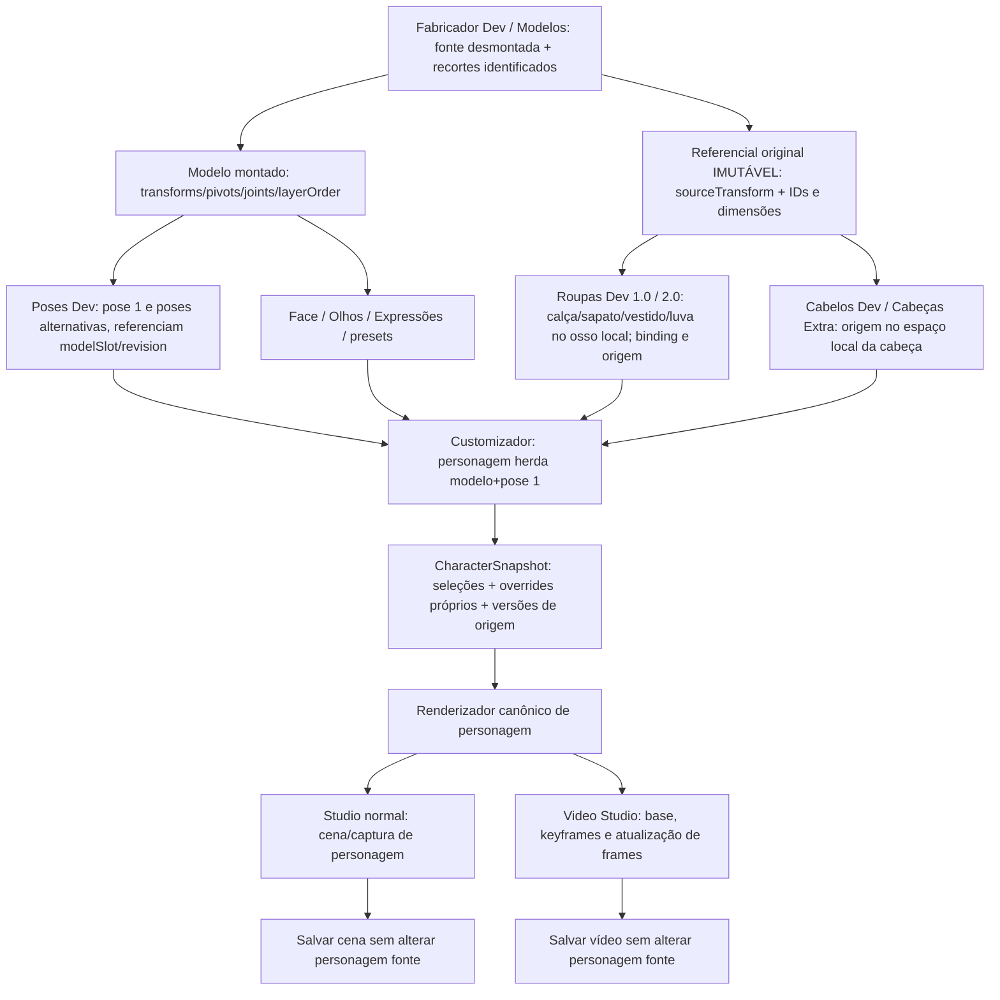

# Contrato de fluxo de assets — Fabricador Dev → Customizador → Studio / Video Studio

**Estado:** contrato alvo e diagnóstico do código em 2026-10-18; algumas proteções e testes sintéticos estão implementados, **a correção visual end-to-end de todas as áreas ainda não está comprovada**.  
**Execução local 2026-10-19:** `audit:all` passou e transforms individuais salvos de Ayla/Chloe alteraram o render real do Customizador em cópias privadas; isso é evidência parcial de AF-08. Não houve edição/salvamento/restart do fluxo da UI, AF-01–AF-20 não está fechado e a equivalência Studio/Video ainda não foi demonstrada. Consulte [relatório local](AUDITORIAS/VALIDACAO_LOCAL_2026-10-19.md).
**Autoridade funcional:** o Fabricador publica bibliotecas de origem; o Customizador cria uma **instância de personagem** que herda encaixes de fábrica e possui seus próprios ajustes; Studio e Video Studio **consomem a apresentação salva no Customizador**, não inventam outro personagem.  
**Referências:** [plano mestre](../PLANO_ESTRUTURA_PROJETO_E_DADOS.md), [roadmap](ROADMAP_EXECUTAVEL.md), [auditoria de evidências](AUDITORIAS/FLUXO_ASSETS_2026-10-18.md), [dados e recuperação](DADOS_E_RECUPERACAO.md), [matriz de isolamento](ISOLAMENTO_STUDIOS_E_DEV_AI.md).

## 1. Regra inegociável de ownership

1. **Fabricador Dev é AUTOR da biblioteca reutilizável.** Edita e publica o modelo rigado, a pose, o conjunto de roupas 1.0/2.0, o cabelo, o rosto, óculos/acessórios e predefinições de expressão. Salvar nesta biblioteca **não** deve alterar automaticamente um personagem já salvo sem política explícita de atualização. Biblioteca é tratada como origem versionada e imutável para leitores.
2. **Customizador é AUTOR do personagem individual**, não da biblioteca. Criar personagem define modelo + pose padrão existente (preferência pose 1) e aplica os ajustes **exatamente como publicados pelo Fabricador**. Modificações de qualquer peça (roupa, sapato, cabelo, olho, óculos, corpo, postura, cor, camada etc.) ficam em **overrides associados ao ID do personagem**, preservando o source.
3. **Studio normal e Video Studio são CONSUMIDORES** do personagem salvo no Customizador. Devem ter **o mesmo render canônico** para o mesmo `characterId`, versão de catálogo, pose, expressão, equipamento e overrides. Só alterações **específicas de cena/animação** pertencem a Studio/Video Studio: posição do ator na cena, timeline, composição e transições. Uma alteração de roupa feita no Studio sem 'Editar personagem no Customizador' não deve modificar o catálogo nem o personagem salvo.
4. **Separação de efeitos:** editar uma biblioteca Fabricador não reescreve instâncias de personagens; editar um personagem A não altera o personagem B, mesmo que utilizem o mesmo `setId` ou `modelSlot`; editar timeline não salva mudança permanente no Customizador; um render não grava.
5. **Dado ausente/incompatível não pode ser silenciosamente omitido.** O motor deve produzir diagnóstico estruturado com `modelSlot`, `setId`, `componentId`, `boneId`, categoria e explicação legível (sem dados privados no log). Fallback compatível só com migração explícita e documentada. Nunca encaixar sapato/cabelo/óculos no primeiro osso arbitrário.

## 2. Pipeline lógico requerido

O **modelo desmontado** é referência de autoria; o **modelo montado** é referência visual e de rig; **poses** são mudanças do rig; **roupas e acessórios** são transformações relativas ao osso de origem. Cada preview deve expor explicitamente qual espaço usa, para não ser confundida com pré-ajuste persistido.

## 3. Estados e coordenadas por workspace

| Etapa | Artefato de origem | Preview correta | Sistema de coordenadas | Salvar modifica | Consumido por |
| --- | --- | --- | --- | --- | --- |
| **Modelos** | Folha original desmontada, recortes PNG, pivôs `sourceTransform`, IDs `ModelPart.id` | Corpo montado + acesso à folha desmontada | Fonte/sheet + rig montado; conversão entre os dois explícita | Biblioteca do **modelo** e rig | Poses, roupas, cabelo, face, Customizador |
| **Poses Dev** | Modelo montado, juntas, pivôs e mesmas peças | Corpo completo montado na pose editável; pose 1 = default preferido | Rig/pose, mantendo IDs de partes e vínculo com revisão original | Biblioteca de **poses** do modelo | Customizador, Studio/Video como `poseSlot` selecionado |
| **Roupas Dev 1.0** | Folha desmontada **do modelo original** e seu mapeamento de partes | Cada peça de roupa sobre **a peça desmontada correta**, e teste em corpo montado/poses | `sourceTransform` + `WardrobeBinding` local do osso | `WardrobeSet` reutilizável de edição 1 | Customizador (mesmo `modelSlot`) |
| **Roupas Dev 2.0** | Referência fixa v2 **apenas quando compatível** (no código: 1122×1402 e 10 peças) + mapping por IDs | Cada roupa montada na folha 2.0; teste em pose real; UI rotula referência v2 | `sourceTransform` de referência calibrada e `WardrobeBinding` persistido | `WardrobeSet.edition=2`; nunca reescrever modelo como efeito colateral | Customizador (mesmo `modelSlot`) |
| **Cabelos Dev** | Recortes frente/atrás/franja vinculados ao mesmo `modelSlot` | **Somente cabeça**, transformações locais separadas por categoria e camada | Head-local, independente do resto do corpo | `HairStyle.transforms` e assets imutáveis | Customizador por seleção e cores individuais |
| **Cabeças Extra** | Óculos, tiaras, chapéus e acessórios de cabeça | **Somente cabeça**, sempre em escala correta; distinguir 'acima do cabelo' | Head-local, defaultTransform salvo no asset | Biblioteca `head-extra` | Customizador, rosto/acessórios |
| **Face / Expressões** | Elementos do rosto, calibrações e presets | Cabeça com composição e guias | Head-local; presets relativos à calibração | Biblioteca face/expressão | Customizador e expressão em Studio/Video |
| **Customizador** | Modelo+pose+equipamentos publicados | Personagem **já com pré-ajustes** de todas as peças, antes de tocar em ajuste local | Rig da pose + modificadores por personagem | Apenas registro `CustomizerCharacter`/overrides | Studio normal e Video Studio |
| **Studio e Video Studio** | `CustomizerCharacter` + renderer comum | O mesmo personagem, salvo efeito/pose específicos da cena | Ator em cena/viewport/timeline, nunca source sheet | Cena ou vídeo, **não** assets de origem | Playback/export |

### Regra de propagação

- Fabricador `sourceTransform` (folha) → binding normalizado (osso) → pose atual (world) → overrides **desta instância** (character) → imagem do personagem → transformações próprias do Studio.
- Ordem de transformações e escala é um **contrato**. Um deslocamento por character é aplicado **depois** do pré-ajuste publicado; `offsetX=0, offsetY=0, scaleX=1, scaleY=1, rotation=0` significa *não mudar nada* e deve reproduzir o preview Fabricador.
- O renderer deve usar `sourceTransform.width/height` ao resolver referências desmontadas, **não** dimensões da peça montada após resize. Para roupas, `binding.boneId === attachedPartId`, e o ID existe na origem e em toda pose compatível.
- `WardrobeSet` não pertence a um personagem; `wardrobeGroups` do personagem guarda ID do conjunto/componente, escolha e delta local. A herança de calibração vem da biblioteca; uma ação `Redefinir ajustes` pode voltar ao binding de fábrica **sem editar Fabricador**.
- Um mesmo boneId não implica que assets de modelos distintos possam ser misturados. Compatibilidade deve usar `modelSlot`, identidade de rig e versão/snapshot; rejeitar `modelSlot` errado, set ausente e peça ausente com aviso, não criar deslocamentos mágicos.

## 4. Contrato de comportamento exigido por exemplos

**Caso A — personagem novo:** crio no Customizador um personagem com modelo salvo e pose 1. Sem alterar nenhuma peça, a roupa e o sapato escolhidos aparecem no local pré-ajustado em Roupas Dev 1.0/2.0; cabelo aparece onde foi ajustado na cabeça; óculos acompanham cabeça. `wardrobeGroups` começa vazio (nenhuma roupa equipada automaticamente, salvo preset inicial publicado); **ao equipar** roupa ela herda integralmente o pré-ajuste sem exigir mover nada. A pose 1 padrão só é selecionável se existir; se faltar, avisar e usar o modelo montado, **não** fingir que uma pose foi carregada.
 
**Caso B — editar personagem A:** duas personagens A/B usam mesmo modelo, mesma pose e mesmo conjunto `setId`. A move o sapato 12 px e troca cor. Só A fica diferente; o `WardrobeSet`, modelo, pose 1 e B permanecem **bit a bit iguais**. Reinicio o app e A preserva seu delta, B mantém default.

**Caso C — nova pose:** alterno pose 1 → pose 2 com braço/perna girados. Roupas seguem IDs/pivôs e transformações; calça/sapato não pulam para o osso errado; cabelos/óculos seguem cabeça; retorno pose 1 recompõe sem deriva.

**Caso D — Studio/Video Studio:** abro personagem A, renderizo mesma pose/expressão/equipamento em Customizador e nos dois Studios. Imagens geradas são equivalentes sob o mesmo viewport/escala/fonte/compositor; keyframes específicos não alteram cadastro base. Ao mudar A no Customizador, refresh explícito respeita política de snapshot/revisão da cena, não overwrites silenciosos.

**Caso E — editar Fabricador após personagens criados:** publicar revisão do modelo ou do conjunto não muda silenciosamente personagens que usam versão antiga. Oferecer `Atualizar assets do personagem` com comparação visual/rollback; personagens novos passam a usar nova revisão. Referências legadas precisam de plano de transição, sem migração destrutiva automática.

## 5. Contratos de persistência e versionamento alvo

O código atual usa `schemaVersion:1`, `modelSlot`, `sourceModelUpdatedAt`, `WardrobeBinding.version:1`, `CustomizerWardrobeGroup` e presets. **Proposta (não aplicada aos dados existentes):**

- Cada asset de biblioteca publicado recebe `assetId`, `revisionId` e `contentHash` (SHA-256 dos metadados normalizados + arquivos) e `sourceModelRevisionId`; versão monotônica ou UUID imutável, com validação de ownership.
- Modelo contém `sourceSheetHash`, `rigHash`, `sourceTransform` canônico por `partId`, juntas/pivôs, `assembledPreviewHash`, dimensões da folha e política de origem. Nunca inferir identidade só pela posição no array de peças.
- Pose contém `sourceModelRevisionId`, `partIds`, pivôs, transformações, ordem e versão. Roupas têm `referenceKind:original|wardrobe-v2` e `bindingReferenceHash` para prevenir misturas invisíveis de referenciais.
- Cada peça de roupa recebe snapshot do pré-ajuste no referencial do osso + `boneId`, dimensões da base, rotação local, pivô e versão do binding. Ajustes do Customizador **não atualizam** esse snapshot.
- Personagem armazena `modelRef/poseRef/equipmentRefs` versionados + `characterOverrides` exclusivos, sem cópias editáveis do original. Escolher política de pinning vs atualização explícita por asset e documentar.
- Studio/Video Studio armazenam `characterId`, `characterRevisionId` e opcional snapshot de render para reproduzir um vídeo antigo. Em atualização, refresh deliberado e diffs; nenhuma referência silenciosamente reinterpreta ajustes.
- Tudo acima deve passar por migração **copiar → verificar hashes → validar round trip → promover ponteiro**; jamais modificar perfil real antes de backup aprovado conforme `DADOS_E_RECUPERACAO.md`.

## 6. O que encontramos no repositório (implementado versus pendente)

**Implementado hoje (análise de código, não E2E validado deste fluxo):**

- `electron/main.ts`: `customizer:characters:create` cria com `modelSlot:1, poseSlot:1` por padrão; a tela pode escolher primeira pose ou fallback ao modelo. Isso **não valida que pose 1 existe** no momento do cadastro.
- `src/shared/fabricator.ts`: modelos com `sourceTransform`, poses com `sourceModelUpdatedAt`, roupas com `WardrobeBinding`, cabelo e `head-extra` com defaultTransform; `src/shared/customizer.ts` possui `partOverrides`, `wardrobeGroups`, palettes, `hairAppearance`, `faceAppearance`.
- `WardrobeWorkspace.tsx`: usa referência desmontada + mapa por ID; no 2.0 há referência fixa compatível; a prévia de teste aplica pose, mas offsets locais de teste (`testDragOffsets`) **não são publicados pelo save do conjunto**.
- `CustomizerPage.tsx`: aplica `mapWardrobeComponentToPose` com source e pose, depois offsets por personagem; `prepareSavedCharacterRenderer` é importado pelos Studios. Algumas falhas de referência eram ignoradas silenciosamente; auditoria de fluxo passa a detectar erros de contrato em fixtures.
- `StudioPage.tsx` e `VideoStudioEditor.tsx`: importam dinamicamente `CustomizerPage.tsx` para renderizar, totalizando 15 ocorrências entre Studio/Video/transitionRenderer. Reuso funcional atual, mas um **acoplamento perigoso de página inteira**, já inventariado no gate de arquitetura.

**Corrigido nesta rodada (código):**

- `src/renderer/src/features/fabricator/wardrobe/boneSelection.ts`: seleção inicial usa `sourceTransform.width/height`, não dimensão atual da peça montada; não atribui arbitrariamente outro osso se não há candidato na zona, nem usa tronco como cabeça para óculos. Isso afeta **novas importações**, não reinterpreta silenciosamente conjuntos antigos.
- `WardrobeWorkspace.tsx`: mantém peças sem vínculo para correção manual e não deixa publicar um conjunto se o osso não existe ou o `binding.boneId` discorda do componente. Requer usuário selecionar/calibrar o osso; não remapeia biblioteca existente.
- `src/shared/assetFlow.ts` e `scripts/audit-wardrobe-flow.mjs`: preflight puro com diagnósticos para referências ausentes, vínculo inválido, revisão divergente e ajuste por personagem imutável; testes para cabeça/sapatos, source-frame, pose e isolamento de personagens.

**Pendente — causas em investigação (não declarar corrigidas):**

- `Roupas 2.0` referência fixa de 1122×1402 com 10 peças pode não corresponder a modelos recortados/reprocessados ou IDs reordenados; associar por índice no processamento da folha original é frágil. Auditar com `partId`/metadados de recorte reais antes de substituir algoritmo.
- Diferenças visuais entre `WardrobeWorkspace` (DOM/CSS transform) e `CustomizerPage` (canvas context/matrix) podem surgir de composição, escala, origem, recorte e ordem de camadas. Precisam de **testes de pixel e coordenadas sobre os mesmos assets sintéticos**; auditoria pura não substitui isso.
- Equipe de roupas não compõe automaticamente no cadastro; só quando seleciona o item no Customizador. Clarificar UX: defaults de pose/modelo vs equipamento default de conjunto; documentado acima.
- Reuso de módulos de página do Customizador pelos Studios precisa ser extraído para um **serviço de renderização puro/canônico** com adapters por área, não copiar três implementações.
- Hairstyle/HeadExtras e face usam transformações head-local distintas; validar em pose 1, pose 2, cabeça redimensionada/rotacionada, layers front/back, acima do cabelo, espelho e recorte.
- Revisões do Fabricador depois do personagem salvo ainda não estão protegidas por snapshots versionados. Sem essa camada, alterar um set de origem pode alterar a aparência de personagens já equipados: **deve ser resolvido com política de versão antes de migrar bibliotecas reais**.

## 7. Matriz de aceite visual/semântica, obrigatória para refatoração de fluxo

| ID | Fixture & ação | Resultado / oráculo | Evidência |
| --- | --- | --- | --- |
| AF-01 | Modelo original desmontado e montado, 10+ peças, IDs embaralhados | mesmo `partId`, pivô e `sourceTransform` estáveis após serializar/reabrir | hashes + grafo |
| AF-02 | Pose 1 e pose 2, 20 movimentos/rotações | sem mudança de source, sem perda de recorte, juntas corretas | DOM/canvas + métricas |
| AF-03 | Roupas 1.0, camisa/luva/meia/sapato | save + reload preservam pré-ajuste e binding | screenshot sheet + pose |
| AF-04 | Roupas 2.0, referência fixa compatível | mesmas peças/IDs após importação; discrepância incompatível gera erro claro | screenshot sheet + pose + diagnóstico |
| AF-05 | Sapato esquerdo/direito e origem deformada | cada um liga ao osso correto pelo referencial desmontado | unit + pixel |
| AF-06 | Roupas legado sem binding | fallback **diagnosticado**, migração reversível, nunca esconde peça silenciosamente | report + backup |
| AF-07 | Personagem novo com pose 1 | pré-ajustes de todas as peças equipadas corretos com deltas neutros | screenshot Customizador |
| AF-08 | Dois personagens usam mesmo asset; A ajusta, B não | biblioteca e B hashes iguais; A mantém ajuste após restart | IPC + hashes |
| AF-09 | Alternância 1↔2 100 vezes com outfit completo | 0 deriva de transformação, 0 perda de peça, fallback só com aviso | screenshot + métricas |
| AF-10 | Cabelos frente/atrás/franja com cabeça redimensionada | pré-ajuste head-local em todas poses e ordem correta | screenshot + diff |
| AF-11 | Óculos/head-extra e layer `renderAboveHair` | seguem pivô e não trocam camada atrás da cabeça | screenshot + diff |
| AF-12 | Corpo/rosto/expressões, roupa em pose e chroma | paleta, skin, face e proporções preservam posição de roupas | screenshot + diff |
| AF-13 | Mesmo personagem em Customizador, Studio e Video Studio | mesmos pixels canônicos sob mesma configuração, diferença de palco documentada | screenshots + hash |
| AF-14 | Atualizar set/modelo Fabricador enquanto há instâncias | versões antigas intactas; refresh controlado com diff; B não muda | hashes + diálogo |
| AF-15 | Crash durante save de modelo/roupa/personagem | arquivo anterior intacto e recuperação determinística | testes filesystem sintético |
| AF-16 | Componente sem osso, arquivo removido ou schema antigo | aviso visível, sem peça invisível silenciosa; backup e instrução de correção | teste negativo + UI |
| AF-17 | Entrar/sair das 5 áreas e editar conjuntos | 0 escrita cross-domain, workers/RAF liberados, saves concluídos | IPC + lifecycle |
| AF-18 | Cenas antigas e character rev antigo após upgrade | abertura sem mudança silenciosa; snapshot/revision pinning | migração fixture |
| AF-19 | Media/pose frame/expressão em vídeo | mesma renderização base, frames/effects exclusivos do vídeo | frame hashes + cenário |
| AF-20 | Pilhas de layers (capa, manga, saia, calça, botas, cabelos) | ordem canônica e compositing idêntico entre previews | pixel diff em 2 DPIs |

**Gate do fluxo:** não alterar storage do usuário ou trocar motor de render até AF-01–AF-20 terem fixtures e definição de fonte. Tests puros executados agora cobrem **parcialmente AF-05, AF-08 e validação de referências**, **não** AF-07, AF-09, AF-10/11 nem a equivalência visual AF-13. Não marcar a matriz inteira verde.

## 8. Etapas recomendadas em ordem

1. Congelar fixtures e capturas das cinco áreas **no app real**, com conjuntos de roupa/head/hair e dois personagens; identificar primeiro ponto de divergência. Criar `assetFlowReport` com IDs, slot, referencial, binding, frame e versão; nunca logar dataURL.
2. Corrigir semântica dos bindings e sua publicação em Roupas 1/2, além de teste determinístico de pose 1/2. Só depois retirar silenciosos `continue` do caminho de composição.
3. Unificar prévia de pose do Fabricador e Customizador em **um renderizador de referência** com adaptadores DOM/canvas e golden images. Separar transformação de render + imagem (não mover página inteira sem testes).
4. Formalizar snapshots de source/revision + copy-on-write por personagem. Planejar migração para `schemaVersion:2` sem apagar V1; compatibilidade de leitura até round-trip/backups verificados.
5. Consolidar renderização de Customizador consumida pelos dois Studios e incorporar AF-* na suíte de CI.
6. Só então remodelar o armazenamento, eliminar import de página inteira e reorganizar pastas sem perder bibliotecas antigas.

**Nota de responsabilidade:** 'Nunca mais ter erro' não é uma garantia técnica literal. O compromisso verificável é **detectar regressões, não descartar peças silenciosamente, preservar dados e executar testes confiáveis antes de cada mudança**.
