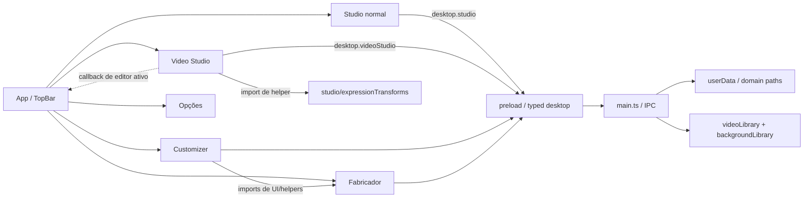

# Inventário, diagnóstico e divergências verificadas

**Escopo:** leitura estática do repositório `nestarasup-sys/G-V5`, branch `master`, commit `5b8483454757f4cc9606c626471aabbeccf35daa`, em 2026-10-18. Todas as referências de linha correspondem a essa base; usar links `blob/<SHA>/<path>#L<n>` para reproduzir. A árvore recursiva retornou **128 entradas** (arquivos e diretórios), sem truncamento. Não foram abertos projetos privados, AppData, filesystem do computador do usuário nem instâncias do app.

## I. Topologia versionada real

```text
G-V5/
  electron/
    main.ts                  # bootstrap, serviços de arquivos e ~75 registrations IPC
    preload.ts               # janela desktop, métodos por domínio
    videoLibrary.ts          # catálogo e cópias de vídeos
    backgroundLibrary.ts     # catálogo e cópias de fundos
    assetImageOverrides.ts
  src/renderer/src/
    main.tsx                 # React StrictMode + HashRouter
    desktop.d.ts             # Window.desktop
    ui/
      App.tsx                # rotas lazy e estado de topbar
      styles.css             # estilos globais + Studio + outras áreas
      components/{TopBar,AppErrorBoundary,CharacterPreview,CharacterPortrait,Icon}.tsx
    features/
      customizer/            # CustomizerPage e regras de imagem
      studio/                # StudioPage e expressionTransforms
      videoStudio/           # editor, timeline, mídia, transições, áudio e CSS próprio
      fabricator/            # modelos, pose, rig, faces, cabelo, wardrobe, design, animação e workers
      options/OptionsPage.tsx
  src/shared/                # contratos de customizer, fabricator, studio, vídeo e helpers
  scripts/                   # 12 audit-*; install-electron.cjs
  docs/PLANO_ESTRUTURA_PROJETO_E_DADOS.md
  package.json / package-lock.json / tsconfig.json / electron.vite.config.ts
  ABRIR_DESENVOLVIMENTO.bat / .gitignore
```

**Entradas:** `src/renderer/src/main.tsx` → `ui/App.tsx` → cinco rotas `/customizar`, `/estudio`, `/video-studio`, `/opcoes`, `/fabricador-dev`. Bundles main/preload/renderer em `electron.vite.config.ts`. `electron/main.ts` cria `BrowserWindow`, registra protocolos `gacha-video` e `gacha-background`, registra handlers e preserva algumas gravações pendentes em `before-quit`. `preload.ts` expõe APIs separadas `studio` e `video-studio`; o tipo agregado está em `src/renderer/src/desktop.d.ts`.

**Dependências declaradas:** React `^19.2.0`, React DOM `^19.2.0`, React Router `^8.4.0`; desenvolvimento Electron `^44.7.1`, electron-vite `^5.0.0`, TypeScript `^5.9.0`, plugin React para Vite `^5.0.0`. Confirmação de versões instaladas e CVEs **não efetuada**; `package-lock.json` está presente. `package.json` só oferece `dev`, `build`, `preview`, `typecheck` e `postinstall`; nenhuma suíte `test`/lint declarada. O inicializador Windows executa `npm install` ou instalador Electron conforme disponibilidade, sem sandbox DEV AI.

**Magnitude estática (não desempenho):** `electron/main.ts` 2.300 linhas / 75 chamadas `ipcMain.handle` / ~15 ocorrências `app.getPath('userData')`; `CustomizerPage.tsx` 3.983 linhas; `VideoStudioEditor.tsx` 2.542; `StudioPage.tsx` 1.653; `FabricatorPage.tsx` 1.085; `FaceComponentsWorkspace.tsx` 1.204; `src/renderer/src/ui/styles.css` ~269 KB e 2.317 linhas, `VideoStudioEditor.css` ~56 KB. Tamanho sinaliza concentração, mas não mede gargalo por si.

## Atualização de execução local — 2026-10-19

A revisão estática acima continua sendo um retrato histórico da base `master@5b848345`. Na branch de continuação `codex/finalizar-dev-ai-local`, testes executáveis foram revalidados; não substituir retroativamente as afirmações históricas por evidência nova. O `npm run audit:all` passou 13/13 casos no SHA limpo `5b82b5a9c4f5b9dda402d30e290517e00f51d2e5` (typecheck, build, nove auditorias rápidas, isolamento Studio e IPC real). O gate AST passou sem imports não resolvidos e sem novas arestas; as 10 arestas legadas continuam classificadas como dívida permitida. Detalhes, comandos e limites em [VALIDACAO_LOCAL_2026-10-19.md](AUDITORIAS/VALIDACAO_LOCAL_2026-10-19.md).

O teste privado de Ayla/Chloe foi executado com backup SHA verificado e cópias independentes. Ambos os renders canônicos mudaram ao zerar transforms exclusivamente na cópia de teste; a biblioteca Fabricador permaneceu idêntica entre as cópias. Evidências visuais e relatórios com dados privados estão fora do repositório. Isso ainda não fecha AF-01–AF-20, ISO-01–ISO-15, nem equivalência entre Customizador e Studios.

## II. Afirmações do plano x implementação — matriz de evidências

| ID / estado | Afirmação e observação verificável | Fonte / implicação |
| --- | --- | --- |
| E-01 **confirmado** | Há divisão renderer/main/preload e contratos TS. | `electron.vite.config.ts`; `src/renderer/src/main.tsx`; `electron/preload.ts` |
| E-02 **confirmado** | Cinco entradas de topbar com rotas lazy. | `ui/App.tsx` e `ui/components/TopBar.tsx` |
| E-03 **incompleto** | Pastas de Studios são diferentes, mas o shell compartilha estado específico da feature: `videoEditorActive` no `App` controlado por callback de `VideoStudioEditor`. | `ui/App.tsx` e `features/videoStudio/VideoStudioEditor.tsx` ~L350; contrato shell→feature reverso requer isolamento |
| E-04 **confirmado** | O Video Studio reutiliza regra pura de Studio normal: `../studio/expressionTransforms`. Compartilhamento pode ser legítimo, mas viola uma futura regra simplista de 'nenhum import cruzado'. | `features/videoStudio/VideoStudioEditor.tsx` L3; extrair contrato puro comum só com testes |
| E-05 **confirmado** | CSS global inclui muitas regras `.studio-*`; Video Studio carrega arquivo CSS próprio. | `ui/styles.css` desde ~L47 e `features/videoStudio/VideoStudioEditor.css`; testar colisões/ordem/cascata |
| E-06 **confirmado** | Há auditoria Studio→Video→Studio com `BrowserWindow({show:false})`, preload fixture, asserts de layout e screenshots; **não foi executada nesta revisão**. | `scripts/audit-studio-isolation.cjs`; testa apresentação, não garante todas as camadas de isolamento |
| E-07 **desatualizado** | Plano descreve ausência de ambiente de testes em termos muito amplos. Não há runner geral, mas há 12 scripts `audit-*` e especificamente auditoria de isolamento. | `scripts/` e `package.json`; adaptar testes preexistentes antes de criar framework novo |
| E-08 **confirmado** | `main.ts` concentra ~75 handlers com validação e IO. | `electron/main.ts`; extrair por domínio preservando contratos e filas |
| E-09 **confirmado** | `studioLibraryPath('studio'/'video')` resolve subpastas distintas `studios/Studio Principal` e `studios/Video Studio`; filas separadas por workspace. | `electron/main.ts` ~L55–61; independência de caminho não prova independência de estado |
| E-10 **confirmado** | APIs preload de Studios têm métodos distintos `saveStudio` e `saveVideoStudio`. | `electron/preload.ts`; `src/shared/studio.ts`; camada de comando precisa assert de namespace |
| E-11 **confirmado** | A raiz persistente é derivada várias vezes de `app.getPath('userData')`; `.gitignore` não contém `app-data/`. | `electron/main.ts` ~L30–56 e `.gitignore`; portabilidade requer design do root antes de mover |
| E-12 **incompleto** | Parte do estado está em `localStorage` e pode ser essencial: catálogo legado Studio, personagem ativo, rascunho de expressão, seleções e âncoras faciais, guias e design settings. | `StudioPage.tsx` L16/L86/L430; `CustomizerPage.tsx` ~L1743; `ExpressionPresetWorkspace.tsx` ~L302/L363; `FaceComponentsWorkspace.tsx` L18–24; `designSettings.ts` L12 |
| E-13 **confirmado** | Existe lógica de migração automática do catálogo legado no mount do Studio e remoção da chave após recarregar; migração de poses usa `rename`. | `StudioPage.tsx` ~L411–435; `electron/main.ts` ~L860–900; risco de mover dados sem cópia imutável |
| E-14 **incompleto** | Alguns manifests usam gravação temporária e `rename`, mas assets podem ser gravados antes de publicar o manifest; não há prova de transação atômica do conjunto. | `electron/main.ts` ~L1060–1090; projetar journal, staging, commit, recuperação |
| E-15 **confirmado** | Há exclusão física `rm(...recursive:true...)` e `unlink` em fluxos Fabricador/bibliotecas. | `electron/main.ts` ~L1830–1900, ~L2090–2140; `electron/videoLibrary.ts` delete/migrate; lixeira recuperável ainda é proposta |
| E-16 **confirmado** | `VideoLibraryStore` usa catálogo com `schemaVersion:1`, IDs UUID, fila serial, cópia temporária, valida tamanho, guarda cópias por roteiro. | `electron/videoLibrary.ts` L1–180; a cópia verifica tamanho, não SHA-256; exigir proteção contra conteúdo trocado de mesmo tamanho |
| E-17 **confirmado** | Validação de documentos limita campos/contagens, mas permite até 100 mil keys/clips e até 70 milhões de caracteres em alguns data URLs. | `electron/main.ts` ~L913–1000; pressionar memória/tempo em benchmarks sintéticos |
| E-18 **confirmado** | O BrowserWindow principal usa `contextIsolation:true`, `nodeIntegration:false`, `sandbox:true`; IPC chama `assertTrustedSender` em handlers inspecionados. | `electron/main.ts` ~L904 e ~L2185; pontos positivos, não certificação de segurança |
| E-19 **incompleto** | `src/renderer/index.html` não declara CSP; criação da janela inspecionada não registra bloqueio explícito de navegação, popup ou policy de permissões. | `index.html`, `electron/main.ts` ~L2185–2200; exigir auditoria em runtime (não alegar exploração) |
| E-20 **confirmado** | Protocolos internos validam IDs UUID para vídeo e fundo. | `electron/main.ts` ~L2205–2277; revisar symlink, range e limites de arquivo |
| E-21 **confirmado** | Workers usam `OffscreenCanvas`/`createImageBitmap` em processamento de imagem; não assumir ausência de paralelismo. | `features/fabricator/face/faceProcessor.worker.ts`; `models/imageProcessor.worker.ts`; `hairProcessor.worker.ts` |
| E-22 **confirmado** | `OptionsPage` é praticamente vazia. Visualizador de logs ainda é iniciativa, não feature observada. | `features/options/OptionsPage.tsx` |
| E-23 **desatualizado** | A referência `docs/STUDIO_WORKSPACES.md` não existe na branch atual; foi excluída por commit `192245e`. | árvore `master`; commit `192245e476cc0a6aab3679373c1c1786919aeca7` |
| E-24 **confirmado no histórico** | Há commit explícito 'Restore normal Studio layout and isolate Video Studio editor' `e352f04`; prova mudança histórica, **não** que a regressão esteja ausente hoje. | commit `e352f04d5b61c9704073f4b957988bd8610ed96c`; script `audit-studio-isolation.cjs` |
| E-25 **não comprovado** | Não há resultados atuais de benchmark, coverage, builds, suíte DEV AI, IPC fuzz, acessibilidade ou prova visual. | ausência de execução nesta revisão; manter gates abertos |
| E-26 **não comprovado** | Estrutura/volume/integridade de dados reais de usuários e capacidades do instalador/release não foram acessados. | repo contém código, não evidência de distribuição de produção |
| E-27 **incompleto** | `TopBar` exibe 'Salvamento automático' como texto estático, sem observar o estado real de operações de persistência nessa implementação. | `ui/components/TopBar.tsx`; exigir estado derivado de operações confirmadas |
| E-28 **confirmado** | Imports transversais além dos Studios: Customizer utiliza `fabricator/usePreviewBackground`, `DesignWorkspace`, `wardrobe/poseTransform`, `face/eyeInteriorMask`. | `features/customizer/CustomizerPage.tsx`; revisar contratos puros vs UI privada |

## III. Grafo funcional observado (simplificado)



As setas indicam imports/chamadas vistos, não um levantamento de todas as dependências transitivas. O acoplamento `V → Route` e `C → F` é uma **fronteira a investigar**, não bug confirmado por teste.

## IV. Inventário inicial de persistência e ciclo de vida

| Domínio | Origem observada | Verificações específicas antes da migração |
| --- | --- | --- |
| Personagens | `userData/customizer/characters` | tamanho de `characters.json`, imagens embutidas vs arquivos, IDs/links e dados iniciais |
| Fabricador | `userData/fabricator/{models,poses,animations,wardrobe,faces,expression-presets,face-components,hair}`, `guides-*.json` | manifests, drafts, histories, fotos, migrações automáticas e exclusões |
| Studio normal | `userData/studios/Studio Principal/studio-<uuid>` | `studio.json`, assets, prints, chave `gacha-nymi-studio-catalog-v1` |
| Video Studio | `userData/studios/Video Studio/studio-<uuid>` e `{media-library,background-library}` | timeline, vídeo/frames, consistência de catálogo e cópias |
| Renderer (perfil Electron) | `localStorage` | chaves do Customizer, design, face, preset; enumerar no perfil real antes de classificar |

**Importante:** os termos acima refletem caminhos de código, **não** diretórios encontrados no computador. Um projeto portátil não deve escrever na pasta protegida do executável; a definição do caminho gravável deve incluir distribuição/atualização, multi-instância e permissões.

## V. Histórico relevante e documentação

- `e352f04`: restauração do Studio normal e isolamento de editor de vídeo, com auditoria dedicada.
- `192245e`: exclusão de documentação legada `docs/STUDIO_WORKSPACES.md`, `docs/PLANO_COMPLETO_VIDEO_STUDIO.md` e `docs/animador-dev-100-ideias.md`.
- `5b84834`: revisão textual/estrutura de plano anterior à presente análise.
- Pull requests públicos #1/#2 abordam transformações de roupa/pose, relevantes para regressão de integração Fabricador→Customizer; não foram usados como prova de teste.
- Verificar commits posteriores à base antes de aplicar tarefas do roadmap. Esta auditoria é um snapshot.

## VI. Lacunas abertas (não inventar confirmação)

1. Hashes reais, conflitos, links externos, paths absolutos, cópia/restauração e perfis de `localStorage` existentes.
2. Distribuição Windows alvo, runtime empacotado, espaços de instalação protegidos, atualização e sistemas operacionais suportados.
3. Reprodução atual da regressão Studio↔Video e efeitos de CSS/timers/atalhos/eventos após 10–100 alternâncias.
4. Semântica de autosave, falha parcial em asset e manifest, perda de energia, dois processos simultâneos e recovery.
5. Frequência e custos reais de render de personagem, timeline, vídeo, base64 e workers; baseline p50/p95.
6. Cumprimento de CSP, URLs não confiáveis, permissões Electron, integridade de arquivos, symlink, MIME magic bytes, deps transitivas.
7. A11y real: foco, teclado, uso sem mouse, leitor de tela, contraste, zoom, erros e loading.
8. Confiabilidade offscreen por plataforma, render GPU, codec e diferenças de screenshot.
9. Faturas/licenças/viabilidade de qualquer runtime alternativo e distribuição sem acesso à rede.
10. Classificação exata de cada chave `localStorage` e de cada exclusão destrutiva.
