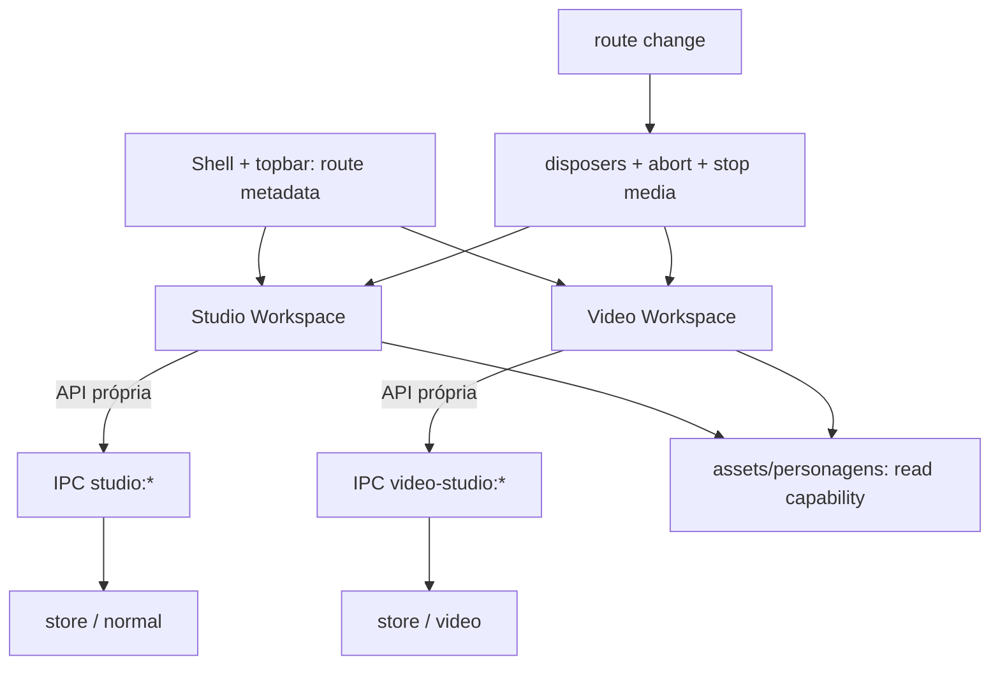

# Isolamento Studio ↔ Video Studio e especificação DEV AI

**Status:** especificação futura, com validação parcial em Windows. A execução `audit:all` de 2026-10-19 passou nos casos implementados de navegação/layout e persistência IPC real em sandbox sintética, inclusive reinício de processo. **A matriz ISO-01–ISO-15 continua incompleta**; os resultados incrementais estão em [validação local 2026-10-19](AUDITORIAS/VALIDACAO_LOCAL_2026-10-19.md), além dos [resultados Windows anteriores](AUDITORIAS/VALIDACAO_WINDOWS_2026-10-18.md) e [baseline inicial](AUDITORIAS/BASELINE_DEV_AI_2026-10-18.md). Evidências: E-03–E-06, E-09–E-10, E-17 e E-24 em [inventário](INVENTARIO_E_EVIDENCIAS.md). Implementação rastreada por R-05/R-10–R-14/R-25–R-27 do [roadmap](ROADMAP_EXECUTAVEL.md).

## 1. Contrato de independência

**Workspace =** `workspaceId`, rota, estado de edição, lifetime, foco, shortcuts, estilos, documento, capa, preview, recursos, contratos IPC e repositório. O `App` hospeda cada workspace; a feature não altera estado do shell por callback livre. Uma capability compartilhada pode fornecer personagens, poses e expressão, **nunca** estado de editor.



**Invariantes:** document IDs podem ter formato idêntico; namespace define ownership. Clonagem explícita não pode criar referência involuntária entre arquivos. Cache de personagens é compartilhável se isolado da seleção e invalidado por versão/evento. `save` apenas resolve depois de commit de manifesto+assets. O vídeo pode alterar a visibilidade da topbar por metadado de rota, nunca por callback assíncrono de componente desmontado. Eventos globais precisam de owner/disposer mensurável; atalhos apenas no editor ativo e respeitando inputs/modais. CSS de feature não muda computed styles de outra.

## 2. Matriz mínima executável

Os nomes `ISO-*` são **IDs de casos a implementar**, não alegação de testes existentes.

| Caso | Setup / ação | Oráculo e artefatos |
| --- | --- | --- |
| ISO-01 Shell | Abrir Studio→Vídeo com roteiro→Studio→Customizar→Vídeo; repetir 100 vezes | topbar visível/oculta por rota e modo declarado; 0 callback tardio; screenshot e trace de navegação |
| ISO-02 CSS | Fixar computed style de grid, inspector, canvas, modal, toolbar e tokens de Studio normal; montar/desmontar Video Studio | diffs sem variação não autorizada; screenshot antes/depois no mesmo viewport, DPR, fonte e modo |
| ISO-03 State | Selecionar elemento, editar inspector e zoom no normal; configurar playhead, faixa, seleção, undo no vídeo | IDs e estados não cruzam; retorno obedece política explícita de restore por workspace |
| ISO-04 Keyboard | Em Studio e Video, disparar atalhos comuns/colidentes, com foco em input/modal, após desmontagens rápidas | só owner atual responde, 0 evento duplicado e 0 comando interceptado no workspace inativo |
| ISO-05 Lifecycle | Ativar vídeo, audio, RAF, timers, workers, observers; navegar e fechar | mídia pausada, tracks liberadas, timer/RAF/listeners/disposers zerados ou retornam ao baseline aceito; nenhum save interrompido |
| ISO-06 IPC | Instrumentar canal e diretório; tentar payload `studio:save` no ID de vídeo, vice-versa, IDs inválidos, objetos grandes | comando rejeita namespace não autorizado; 0 escrita fora do dono; erro estável e redigido |
| ISO-07 Storage | Seeds em `studios/normal` e `studios/video`, snapshots SHA-256 de ambos; alterar/apagar um deles em sandbox | hash da pasta não alvo idêntico, incluindo `studio.json`, arquivos/frames/libraries |
| ISO-08 Crash/recovery | Kill após staging de asset e antes/depois do manifest de cada Studio | reabre versão íntegra prévia ou nova; nunca referências quebradas; journal rastreável |
| ISO-09 Shared capability | Modificar personagem/expressão no Fabricador; recarregar os dois Studios | atualização compartilhada somente via contrato; seleção, playhead e docs independentes |
| ISO-10 CSS perturbation | Alterar estilo sintético restrito a vídeo em fixture/test-build | mudanças da área vídeo não atingem Studio normal; regras globais denunciadas pelo linter |
| ISO-11 Async race | Fechar/trocar área enquanto lista/promessa de save/preview está em voo | nenhuma atualização de estado desmontado, render antigo nem toast falso; saves persistentes completam com ownership correto |
| ISO-12 Fullscreen | Abrir e fechar preview vídeo, mudar rota no meio, resize/DPR | estilos e topbar restaurados; foco correto, sem overlay órfão |
| ISO-13 Long run | 100 alternâncias com timeline carregada e frames, medindo RSS/handles | sem tendência monotônica relevante fora de ruído; relatório de memória/handles |
| ISO-14 UI regression | Smoke de Customizer, Fabricador e Opções após alterar shell/global CSS/preload | rotas, foco e operações não degradados |
| ISO-15 Media | Video library import/attach/delete com arquivos sintéticos válidos e inválidos | isolamento de catálogo/cópia; import rejeita malware/traversal/formato falso sem modificar dados alheios |

**Cobertura mínima por PR:** mudança apenas em vídeo → ISO-01/02/03/04/05/06/07/12 + smoke normal; mudança no Studio → mesmos casos invertidos; `App`, `TopBar`, CSS global, `shared`, preload/IPC/storage → ISO-01–15 e smoke de todas as áreas. Para uma mudança de mídia, rodar também protocolos/range, grande volume e cancelamento. A lista de cobertura é um gate, não substituto de revisar impacto real.

## 3. Runner e fronteira de confiança

**Arquitetura preferida a validar:**

```text
dev-ai/                       # ferramenta local, NÃO inclusa no release
  cli.ts                      # entrypoint; allowlist de suites
  runner/{registry,planner,reporter,limits}.ts
  adapters/{unit,dom,ipc-electron,storage,media,visual,perf}.ts
  fixtures/{small,medium,large,malformed}/
  suites/{smoke,studio-isolation,ipc,storage,migration,visual,a11y,perf}/
  schemas/{suite,report}.ts
tests/{unit,integration,e2e,performance}/
  # outputs SEMPRE em diretório temporário canônico isolado
```

- **CLI sem dependência do painel.** Interface DEV AI apenas apresenta relatório e invoca IDs cadastrados; não oferece `exec(command)`, shell genérico, acesso a dados de usuário nem execução de código não revisado.
- **Adapters em níveis:** funções puras (Node/Vitest candidato), DOM em Chromium (Playwright candidato), Electron real (preload e IPC/FS reais) e fixture-preload de baixo custo (compatibilidade visual). A suíte fixture **não** substitui teste da ponte real.
- **Offscreen verdadeiro:** `BrowserWindow({show:false})` testa uma janela não visível; `webPreferences.offscreen` do Electron é capacidade distinta e deve passar PoC com pintura/captura por plataforma. No Linux, CI pode exigir servidor de vídeo virtual, container ou render software — não prometer headless nativo universal. Gravar no report qual backend foi usado, requisitos e limitações de codecs/GPU.
- **Ambiente isolado:** usar `mkdtemp` sob root próprio, resolver `realpath`; setar `app.setPath('userData', sandbox)` e `sessionData` **antes de `app.whenReady()`**; injetar `dataRoot` da fixture e perfil temporário. Abortá-lo se `userData` ou root resolverem para paths reais, repo, home ou fora da área explicitamente criada.
- **Controles:** processos filhos exclusivos com PID tree, timeout, cancelamento, quotas e limites de CPU/RSS quando SO suportar, workspace lock, porta única e política de rede bloqueada por default; nenhuma dependência pode fazer upload. Validar `testOnly=true` no processo main, sem confiar só no renderer.
- **Teardown:** esperar flush de fila, matar processos filhos, soltar arquivos/ports, afirmar ausência de handles pendentes; apagar **somente** o subdiretório canônico criado pelo próprio runner após verificar marcador `dev-ai-sandbox`, propriedade e destino. Reter logs/screenshots sanitizados, não mídias sem revisão.
- **Fixtures:** sem personagens/imagens reais; imagens raster geradas localmente (PNG/JPEG/WebP), vídeos sintéticos gerados localmente somente se codec binário aprovado/disponível, projetos com 0/1/100/1000 objetos e limites de schema, vídeos de 1/30/100 faixas, arquivos malformados/truncados e volumes de dados parametrizados.
- **Reprodução:** seed fixa e relógio controlado para testes determinísticos; hashes de fixture e baseline visual versionados; PRs não atualizam golden automaticamente; diferenciar resultados `pass`, `fail`, `skipped`, `unsupported`, `inconclusive`.

## 4. Contrato de suíte e relatório (proposto, não implementado)

```ts
type SuiteDefinition = {
  id: string; moduleId: string; class: 'unit' | 'dom' | 'electron-ipc' | 'visual' | 'perf' | 'migration';
  fixtureId: string; dependencies: string[]; timeoutMs: number;
  network: 'deny'; writes: 'sandbox-only'; assertions: string[];
  artifacts: Array<'screenshot' | 'trace' | 'metrics' | 'redacted-log' | 'hashes'>;
}
type RunReport = {
  schemaVersion: 1; runId: string; commit: string; platform: string;
  runnerVersion: string; electronVersion?: string; chromiumVersion?: string;
  fixtureHash: string; startedAt: string; endedAt: string; viewport?: {width:number;height:number;dpr:number};
  gpuMode: string; codecSupport: string[];
  status: 'pass' | 'fail' | 'skipped' | 'unsupported' | 'inconclusive';
  cases: Array<{id:string;status:string;durationMs:number;artifactPaths:string[];errorCode?:string}>;
  metrics?: Record<string, {unit:string;p50:number;p95:number;sampleCount:number}>;
  sandboxRootHash: string; outsideSandboxWrites: number;
}
```

`outsideSandboxWrites === 0` deve ser instrumentado/verificado (FS mocks e auditoria do adapter real), não assumido por boa intenção. Hash de path evita expor diretório pessoal; `artifactPaths` apenas relativos ao root de run.

**Comandos futuros sugeridos** (não disponíveis hoje): `npm run test:unit`, `npm run test:ipc`, `npm run dev-ai -- --suite studio-isolation --fixture small`, `npm run dev-ai -- --suite regression --headless`, `npm run dev-ai -- --suite perf --fixture large --repeat 20`. Depois de implementar, README deverá listar versões, flags e exemplos funcionando, inclusive em Windows.

## 5. Capturas, baseline e profiling

Em cada captura fixar: commit, SO, Electron/Chromium, DPR, zoom, viewport, fontes, tema, seed, posição de scroll/playhead, animações reduzidas, tempo de estabilização e política de máscara. Comparar pixels e regiões sem mascarar layout errado; diffs >limiar provisório exigem inspeção humana. Falha de captura gera `inconclusive` e bloqueia, nunca `pass`.

Métricas: performance marks (`cold-start`, `workspace-ready`, `first-preview`, `seek-to-paint`, `save-request-to-commit`), React Profiler para renders, `process.getProcessMemoryInfo`/RSS + heap JS, CPU e número de RAF/listeners/handles, contagens IO, tamanhos de base64 e tempo de decodificação. Guardar p50, p95, pico, N e variance; comparar somente na mesma máquina/configuração. Performance do compositor offscreen pode diferir de janela real: dois perfis, não misturar séries.

## 6. Critérios de pronto do DEV AI

- [ ] Runner executa CLI de novo checkout sem janelas visíveis e sem intervenção manual, ou informa claramente suporte incompleto.
- [ ] Fixture, perfil Electron e `dataRoot` isolados; teste tenta escrever em path real e é bloqueado.
- [x] Auditoria visual existente e suite IPC real reproduzem, respectivamente, layout por fixture e isolamento de pastas com namespace/storage real; cobertura parcial registrada em [validação Windows](AUDITORIAS/VALIDACAO_WINDOWS_2026-10-18.md).
- [ ] Matriz ISO-01–15 implementada com artefatos pass/fail rastreáveis; regressão do Studio não pode passar ao alterar vídeo sem medir o Studio.
- [ ] Traces, screenshots, hashes e reports JSON são redigidos, locais, versionados por schema e reproduzíveis.
- [ ] Sem dependência de painel; painel dev-only passa teste de indisponibilidade em release.
- [ ] Falhas, timeout, crash, rede bloqueada e processo órfão são capturados/limpos com relatório de causa.
