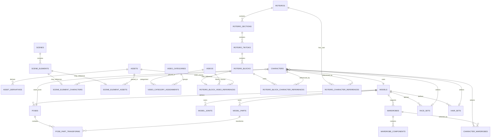

# Desenho inicial do schema SQLite

**Estado:** proposta da tarefa F02.02; ainda não é uma migration nem um banco implementado.  
**Banco:** `database/gv5.sqlite3`, dentro da raiz retornada por `IAppDataPaths`.  
**Regra:** `GV5.Data` controla conexão, migrations e transações. Cada domínio possui as tabelas abaixo e expõe operações por contratos de Application; nenhuma tela ou módulo acessa SQLite diretamente.

## Convenções comuns

- IDs públicos são GUIDs não vazios serializados como texto no formato canônico `D` (36 caracteres). IDs internos de peças/elementos usam chaves locais explícitas e únicas dentro do agregado. Não usar nome, índice de lista ou caminho físico como identidade.
- Cada agregado editável tem `revision INTEGER NOT NULL CHECK (revision >= 1)`, `created_utc_ms INTEGER NOT NULL` e `updated_utc_ms INTEGER NOT NULL`. Instantes são Unix milliseconds em UTC; revisão é monotônica e atualizada sob comparação com `expectedRevision`.
- Relações consultadas/ordenadas com frequência são colunas e FKs. JSON é reservado a atributos variáveis ou payloads específicos versionados (`*_json`, `*_schema_version`); IDs, ownership, ordem e valores necessários a pesquisa/uniqueness não ficam escondidos em JSON.
- Imagens, vídeos e outros binários ficam fora do SQLite. Tabelas guardam IDs de asset, hash, metadados e referências relativas ao armazenamento controlado por GV5.Data. Nunca gravar bytes/base64 no JSON do agregado.
- Deletar uma referência não deleta um asset compartilhado. FKs entre domínios usam `RESTRICT`; filhos realmente pertencentes a um agregado podem ser apagados em uma operação explícita do repositório. Entidades removíveis devem manter tombstone até a política de retenção/limpeza ser implementada.
- Escritas de um agregado e de seus filhos ocorrem em uma transação. Campos de conteúdo e revisões são salvos juntos; transações de arquivos e DB são coordenadas por journal/recuperação, não presumidas atômicas.

## Contratos relacionais por agregado

As tabelas de domínio usam chaves primárias estáveis e chaves compostas adicionais onde uma relação precisa provar o mesmo proprietário. Exemplo: `model_parts` tem `PRIMARY KEY(part_id)`, `UNIQUE(model_id, part_id)` e `UNIQUE(model_id, sort_order)`; qualquer filho que referencia uma parte inclui `model_id` na FK. Assim, uma pose ou roupa não consegue apontar acidentalmente para uma parte de outro modelo. O mesmo padrão vale para `poses`, `wardrobes`, `face_sets` e `hair_sets`, expondo `UNIQUE(model_id, <id>)` para as FKs compostas.

| Agregado | Chave/ownership propostos | Relacionamentos que devem ser protegidos |
| --- | --- | --- |
| Modelo | `models(model_id)`; partes e juntas têm `model_id`; partes expõem `UNIQUE(model_id, part_id)`. | Juntas referenciam pai/filho por `(model_id, part_id)`; excluir modelo remove seus filhos apenas por comando explícito e transação. |
| Pose | `poses(pose_id)` + `UNIQUE(model_id, pose_id)`; transforms têm `model_id`, `pose_id`, `part_id`. | FK `(model_id, pose_id)` para pose e `(model_id, part_id)` para parte; PK `(pose_id, part_id)` impede transformação duplicada. |
| Roupa | `wardrobes(wardrobe_id)` + `UNIQUE(model_id, wardrobe_id)`; componentes incluem `model_id` e `wardrobe_id`. | FK composta para roupa e, quando ancorado numa parte, `(model_id, anchor_part_id)`; asset referenciado separadamente por `asset_id`. |
| Personagem | `characters(character_id)` com `model_id`, `pose_id`, `face_set_id?`, `hair_set_id?`. | FKs compostas `(model_id, pose_id/face_set_id/hair_set_id)` asseguram compatibilidade de modelo. Relações de roupas carregam `character_id`, `model_id`, `wardrobe_id` e FK composta para roupa do mesmo modelo. |
| Cena | `scenes(scene_id)`; `scene_elements(element_id)` com `scene_id` e `z_order`. | Elemento tem FK para cena e referências tipadas em tabelas de ligação (personagem ou asset), evitando coluna polimórfica que não possa ser validada por FK. |
| Biblioteca de vídeos | `videos(video_id)`; `video_category_assignments(video_id, category_id)`; `assets(asset_id)` armazena o binário. | Vídeo e asset têm FK restritiva; excluir atribuição/categoria não exclui o vídeo nem o asset. |
| Roteiro | `roteiros(roteiro_id)` → `roteiro_sections(section_id)` → `roteiro_tiktoks(tiktok_id)` → `roteiro_blocks(block_id)`. | Cada nível inclui a chave do pai e `UNIQUE(parent_id, sort_order)`. Referências externas vivem em tabelas de ligação com FKs; não são IDs opacos dentro do JSON. |

IDs de revisão publicados são imutáveis. O agregado editável mantém sua revisão otimista; quando uma entidade consumível for publicada, as tabelas de revisões e suas FKs incluem `(entity_id, revision)`, e consumidores guardam essa chave composta. A migration deve rejeitar atualização de uma revisão publicada; publicação cria outra revisão. O payload flexível de cada revisão pode ser versionado, mas referências, ownership e ordem permanecem relacionais. O DDL definitivo dessa regra será especificado na migration que introduzir o primeiro agregado publicável, evitando inventar tabelas vazias para todos os domínios antes do consumidor existir.

Vídeo de roteiro tem dois casos distintos: vídeo já publicado na biblioteca (`video_id`) e mídia privada ainda em rascunho (`asset_id`). A ligação deverá ser normalizada em `roteiro_block_video_references` com `block_id` como PK, `source_kind` restrito a `library|draft`, colunas nullable `video_id`/`asset_id` e `CHECK` que exige exatamente a FK correspondente ao tipo. Isso preserva a regra de que remover um vídeo do roteiro só remove sua referência, enquanto a biblioteca e o asset continuam intactos.

`roteiro_block_character_references(block_id, character_id, role, sort_order)` associa personagens ao bloco correto; o agregado de roteiro também pode ter uma tabela `roteiro_character_references(roteiro_id, character_id)` para elenco global. São usos diferentes e não devem ser confundidos.

## Ownership e tabelas

| Dono | Tabelas propostas | Chaves e relações principais |
| --- | --- | --- |
| Plataforma (`GV5.Data`) | `schema_migrations` | `version INTEGER PRIMARY KEY`, `name`, `checksum`, `applied_utc_ms`; somente o coordenador de migrations escreve. |
| Assets | `assets`, `asset_derivatives` | `asset_id` estável; `sha256` único para conteúdo idêntico; MIME/tamanho/caminho relativo e estado de verificação. Derivados apontam para source/output por AssetId e guardam kind, recipe hash e versão do gerador. Bytes ficam em `assets/` ou `thumbnails/`. |
| Fabricador | `models`, `model_parts`, `model_joints`, `poses`, `pose_part_transforms`, `wardrobes`, `wardrobe_components`, `face_sets`, `hair_sets` | `models` é o agregado editável inicial com `model_id`, revisão, nome e datas; partes/juntas são filhos relacionais. Pose e roupa guardam `model_id`; transforms apontam para peças do mesmo modelo; componentes de roupa apontam para peça de ancoragem e asset. Conjuntos de rosto/cabelo são catálogos publicados com revisão própria. `UNIQUE(model_id, sort_order)` ou chave equivalente protege ordem sem torná-la identidade. |
| Customizador | `characters`, `character_wardrobes` | Personagem referencia `model_id`, `pose_id` e, quando aplicável, `face_id`/`hair_id`; associação ordenada N:N aponta a `wardrobe_id`. Overrides privados ficam em `overrides_json` versionado; referências tipadas comuns continuam em colunas/FKs. O Customizador não altera tabelas publicadas pelo Fabricador. |
| Studio | `scenes`, `scene_elements`, `scene_element_characters`, `scene_element_assets` | Cena guarda dimensões e revisão; elementos guardam `kind`, `z_order` e transformações comuns. Tabelas de ligação com FKs tipadas apontam para personagem ou asset; atributos específicos usam JSON versionado. |
| Base de Vídeos | `videos`, `video_categories`, `video_category_assignments` | `videos.video_id` estável e `asset_id` do arquivo; duração, resolução, FPS, codecs, hash e estado são metadados consultáveis. Categorias têm ID próprio e cor; associação N:N por IDs. Excluir categoria exige operação que resolva suas associações; não exclui os vídeos. |
| Roteiros | `roteiros`, `roteiro_sections`, `roteiro_tiktoks`, `roteiro_blocks`, `roteiro_block_video_references`, `roteiro_block_character_references`, `roteiro_character_references` | Hierarquia ordenada por IDs estáveis; blocos guardam tipo e texto/campos consultados em colunas, campos variáveis em JSON versionado. Vídeo de biblioteca ou asset privado é referenciado em relação tipada; personagens são relações por `character_id`. Roteiros não copiam a biblioteca de vídeos. |

## Relações entre módulos

O diagrama apresenta ownership e relações de domínio; nomes de IDs locais e tabelas poderão ser ajustados quando os tipos executáveis forem definidos, sem alterar a regra de IDs estáveis nem embutir a biblioteca em documentos. Para tabelas de ligação de referência opcional, o par de FKs e o `CHECK` impedem simultaneamente referência a vídeo e a asset, ou ausência de ambos.

## Índices e constraints previstos

- PK para cada ID estável e FKs habilitadas em toda conexão. Índices nas FKs e colunas de filtro/listagem: `(model_id, sort_order)`, `(scene_id, z_order)`, `(roteiro_id, sort_order)`, `(section_id, sort_order)` e `(tiktok_id, sort_order)`. FKs compostas têm o mesmo prefixo/ordem que a chave UNIQUE referenciada.
- Unicidade para o hash de conteúdo, para posição dentro do mesmo pai e para cada par N:N. Reordenamento troca posições dentro de uma única transação para respeitar `UNIQUE(parent_id, sort_order)`. Não impor unicidade global por nome exibido.
- `CHECK` para revisão positiva, largura/altura e duração não negativas, FPS válido quando conhecido, enumeração de tipos reconhecidos e cores em formato validado. Campos desconhecidos não viram enums fechados sem política de compatibilidade.
- Índices de pesquisa só depois de uma query real justificar o custo; evitar índices duplicados e JSON indexes como substituto de normalização.

## Política de gravação incremental

Repositórios atualizam apenas as linhas do agregado alterado, filtrando pelo ID e `expectedRevision` na mesma transação. Uma operação que não altera conteúdo devolve sucesso sem executar `UPDATE`; mudança de um modelo não reescreve outras entidades nem serializa o banco inteiro. Ao persistir filhos no futuro, o repositório compara IDs/valores dirty e insere, atualiza ou remove apenas as linhas alteradas, com o agregado como limite transacional. WAL é mecanismo interno de recuperação e concorrência do SQLite; não é um snapshot do banco por gesto.

## Journal executável de rascunhos (migration 3)

`model_draft_checkpoints` é um write-ahead journal pequeno para operações de `ModelDraft` que ainda não foram confirmadas. O registro guarda um `checkpoint_id` imutável, `model_id` estável, a revisão-base esperada (NULL para criação), o nome pretendido e o instante da captura. Ele não tem FK para `models`, pois uma criação precisa ser registrada antes de a linha do modelo existir. O índice por modelo/horário permite procurar checkpoints pendentes e reproduzir cada operação de forma determinística.

O Fabricador grava o checkpoint antes do `CreateAsync`/`UpdateAsync`. Repetir um salvamento pendente atualiza o mesmo checkpoint pelo ID, sem acumular snapshots duplicados. Depois do commit do agregado, remove apenas o checkpoint daquele ID. Na abertura do Fabricador, checkpoints são apresentados ao usuário: recuperar tenta aplicar usando a revisão esperada; se a revisão já avançou e o conteúdo confere, reconhece o commit como concluído e só limpa o journal; se divergiu, mantém o checkpoint e nunca substitui silenciosamente a versão atual. Descartar remove somente o checkpoint, sem apagar o modelo confirmado. O teste de interrupção injeta falha depois do write-ahead, cria um novo ViewModel e verifica a recuperação em SQLite de arquivo temporário.

## Backup executável SQLite (formato 1)

`DatabaseBackupService` cria cada backup em uma pasta nova, usando a API online backup do SQLite enquanto o gate de escrita local está fechado. Isso copia uma visão transacional consistente que inclui páginas committed ainda residentes em WAL; não copia o arquivo principal isoladamente. A pasta contém `database/gv5.sqlite3` e `manifest.json`. O manifesto guarda versão do formato/schema, timestamp UTC e tamanho/SHA-256 do banco. O serviço verifica caminho relativo permitido, formato, tamanho, hash, `integrity_check`, `foreign_key_check` e versão real do schema antes de aceitar o backup.

Restore exige uma raiz de dados nova sem banco existente, copia para um arquivo temporário, recalcula o hash e executa as verificações SQLite antes de mover o arquivo para o destino. Não sobrescreve banco existente. A versão 1 inclui somente o SQLite porque ainda não existe AssetStore binário; quando o AssetStore entrar, seus arquivos deverão ser incorporados ao manifesto/hash antes do backup ser considerado completo para dados de assets.

## Contrato público do AssetStore (F03.01)

`AssetId` é um GUID tipado e não vazio, serializado no formato canônico `D`; nome exibido, hash e caminho físico não substituem sua identidade. `IAssetStore` oferece `ImportAsync`, `OpenReadAsync`, `GetMetadataAsync`, `AddReferenceAsync` e `ReleaseReferenceAsync`, sempre por ID/stream e sem expor caminhos físicos. A stream de entrada continua pertencendo ao chamador; a stream retornada por `OpenReadAsync` pertence ao chamador e deve ser descartada por ele.

`AssetMetadata` expõe somente ID, SHA-256, MIME type, tamanho, estado de verificação e data de criação. Localização relativa e detalhes de armazenamento ficam dentro de `GV5.Data`. `AssetReferenceKey` é a chave estável `(owner_type, owner_id, slot)`, validada como identificadores ASCII minúsculos com separadores simples. Adicionar a mesma relação é idempotente; ocupar a mesma chave com outro asset retorna conflito. Liberar uma chave remove apenas a relação e não apaga o binário. Importação e lifecycle dos arquivos serão implementados nas tarefas F03.02–F03.04.

F03.02 introduz staging temporário de imagens via stream não necessariamente seekable, cópia limitada e SHA-256 incremental. Tipos suportados na importação inicial: PNG, JPEG e WebP; o MIME declarado precisa corresponder à assinatura. Os limites padrão de staging são 256 MiB, 16.384 pixels por eixo e 100 milhões de pixels totais. O parser lê somente os cabeçalhos estruturais para classificar tipo/dimensões; decodificação completa e validação de pixels/alpha ficam para F03.05. Arquivos de staging usam nomes aleatórios e são removidos ao descartar a importação ou após erro/cancelamento; o arquivo por hash e a gravação de metadados chegam em F03.03.

## Journal de publicação de assets (migration 4)

`asset_import_journal` contém a intenção durável de publicar um asset antes de criar sua linha final em `assets`. O registro associa `operation_id`, `asset_id`, SHA-256, caminho relativo derivado do hash, arquivo temporário de operação, MIME type, tamanho e dimensões do cabeçalho. O journal deliberadamente não tem FK para `assets`, pois ele precisa existir antes da publicação do arquivo e do metadado definitivo.

O pipeline valida e grava o stream em staging, copia para `temp/asset-operations/<operation-id>.stage` verificando de novo tamanho/hash, confirma o journal em SQLite e então move o arquivo para `assets/sha256/<prefixo>/<sha256>`. A movimentação ocorre dentro da mesma raiz de dados e não sobrescreve um destino; arquivos existentes só são aceitos após verificação do tamanho e SHA-256. A criação do metadado e a remoção do journal acontecem juntas numa transação SQLite.

Antes de cada operação pública, a recuperação percorre os journals: se só o stage existe, verifica e publica; se só o destino existe, verifica e finaliza a linha SQLite; se ambos existem, valida o destino e remove o stage excedente. Hash/tamanho divergentes ou ausência dos dois arquivos preservam o journal e falham sem apagar nem substituir bytes. Se houver uma linha `assets` sem arquivo, `GetMetadata` registra `missing`; se o mesmo arquivo reaparecer, tamanho/hash são verificados antes de voltar para `available`. Arquivos temporários sem journal, possíveis se o processo cair antes da confirmação do journal, não são apagados automaticamente nesta tarefa.

Migration 4 cria apenas o journal de publicação. A migration 1 continua dona dos metadados finais `assets`/`asset_derivatives`; relações persistentes de owner/slot são uma mudança posterior separada.

**Limite de backup atual:** o formato 1 do `DatabaseBackupService` ainda copia somente SQLite e não inclui os arquivos em `assets/sha256`. Portanto, ele não é um backup completo dos binários criados nesta fase. A cobertura de backup/restore dos arquivos deve ser concluída antes do gate final de F03 e do uso de assets como dados de usuário.

## Decisões ainda adiadas

O desenho não escolhe o provider SQLite, DDL definitivo, política WAL, journal, schema versions ou semântica exata de `ON DELETE`; isso pertence a F02.03–F02.04 e às tarefas de recovery. As tabelas de domínios futuros são contratos conceituais, não autorização para antecipar módulos fora da ordem do plano.
