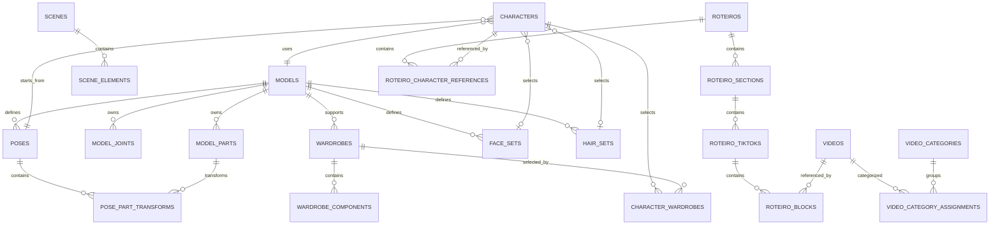

# Desenho inicial do schema SQLite

**Estado:** proposta da tarefa F02.02; ainda não é uma migration nem um banco implementado.  
**Banco:** `database/gv5.sqlite3`, dentro da raiz retornada por `IAppDataPaths`.  
**Regra:** `GV5.Data` controla conexão, migrations e transações. Cada domínio possui as tabelas abaixo e expõe operações por contratos de Application; nenhuma tela ou módulo acessa SQLite diretamente.

## Convenções comuns

- IDs públicos são GUIDs não vazios serializados como texto no formato canônico `D` (36 caracteres). IDs internos de peças/elementos usam chaves locais explícitas e únicas dentro do agregado. Não usar nome, índice de lista ou caminho físico como identidade.
- Cada agregado editável tem `revision INTEGER NOT NULL CHECK (revision >= 1)`, `created_utc_ms INTEGER NOT NULL` e `updated_utc_ms INTEGER NOT NULL`. Instantes são Unix milliseconds em UTC; revisão é monotônica e atualizada sob comparação com `expectedRevision`.
- Relações consultadas/ordenadas com frequência são colunas e FKs. JSON é reservado a atributos variáveis ou payloads específicos versionados (`*_json`, `*_schema_version`); IDs, ownership, ordem e valores necessários a pesquisa/uniqueness não ficam escondidos em JSON.
- Imagens, vídeos e outros binários ficam fora do SQLite. Tabelas guardam IDs de asset, hash, metadados e referências relativas ao armazenamento controlado por GV5.Data. Nunca gravar bytes/base64 no JSON do agregado.
- Deletar uma referência não deleta um asset compartilhado. FKs entre domínios usam `RESTRICT`; filhos realmente pertencentes a um agregado podem ser apagados em uma operação explícita do repositório. Entidades removíveis devem manter tombstone até a política de retenção/limpeza ser implementada.
- Escritas de um agregado e de seus filhos ocorrem em uma transação. Campos de conteúdo e revisões são salvos juntos; transações de arquivos e DB são coordenadas por journal/recuperação, não presumidas atômicas.

## Ownership e tabelas

| Dono | Tabelas propostas | Chaves e relações principais |
| --- | --- | --- |
| Plataforma (`GV5.Data`) | `schema_migrations` | `version INTEGER PRIMARY KEY`, `name`, `checksum`, `applied_utc_ms`; somente o coordenador de migrations escreve. |
| Assets | `assets`, `asset_derivatives` | `asset_id` estável; `sha256` único para conteúdo idêntico; extensão/MIME/tamanho/caminho relativo e estado de verificação. Derivados (thumbnail/proxy) apontam para asset-fonte e guardam kind/versão do gerador. Bytes ficam em `assets/` ou `thumbnails/`. |
| Fabricador | `models`, `model_parts`, `model_joints`, `poses`, `pose_part_transforms`, `wardrobes`, `wardrobe_components`, `face_sets`, `hair_sets` | Modelo possui peças/juntas. Pose e roupa guardam `model_id`; transforms apontam para peças do mesmo modelo; componentes de roupa apontam para peça de ancoragem e asset. Conjuntos de rosto/cabelo são catálogos publicados com revisão própria. `UNIQUE(model_id, sort_order)` ou chave equivalente protege ordem sem torná-la identidade. |
| Customizador | `characters`, `character_wardrobes` | Personagem referencia `model_id`, `pose_id` e, quando aplicável, `face_id`/`hair_id`; associação ordenada N:N aponta a `wardrobe_id`. Overrides privados ficam em `overrides_json` versionado; referências tipadas comuns continuam em colunas/FKs. O Customizador não altera tabelas publicadas pelo Fabricador. |
| Studio | `scenes`, `scene_elements` | Cena guarda dimensões e revisão; elementos guardam `kind`, `z_order`, transformações comuns, referências opcionais `character_id`/`asset_id` e atributos específicos em JSON versionado. `scene_elements` pertence à cena. |
| Base de Vídeos | `videos`, `video_categories`, `video_category_assignments` | `videos.video_id` estável e `asset_id` do arquivo; duração, resolução, FPS, codecs, hash e estado são metadados consultáveis. Categorias têm ID próprio e cor; associação N:N por IDs. Excluir categoria exige operação que resolva suas associações; não exclui os vídeos. |
| Roteiros | `roteiros`, `roteiro_sections`, `roteiro_tiktoks`, `roteiro_blocks`, `roteiro_character_references` | Hierarquia ordenada por IDs estáveis; blocos guardam tipo e texto/campos consultados em colunas, campos variáveis em JSON versionado. Referências de vídeo apontam por `video_id` (ou `asset_id` próprio para rascunho); personagens são relações por `character_id`. Roteiros não copiam a biblioteca de vídeos. |

## Relações entre módulos

O diagrama apresenta ownership e relações de domínio; nomes de IDs locais e tabelas poderão ser ajustados quando os tipos executáveis forem definidos, sem alterar a regra de IDs estáveis nem embutir a biblioteca em documentos.

## Índices e constraints previstos

- PK para cada ID estável e FKs habilitadas em toda conexão. Índices nas FKs e colunas de filtro/listagem: `(model_id, sort_order)`, `(scene_id, z_order)`, `(roteiro_id, sort_order)`, `(section_id, sort_order)` e `(tiktok_id, sort_order)`.
- Unicidade para o hash de conteúdo, para posição dentro do mesmo pai e para cada par N:N. Não impor unicidade global por nome exibido.
- `CHECK` para revisão positiva, largura/altura e duração não negativas, FPS válido quando conhecido, enumeração de tipos reconhecidos e cores em formato validado. Campos desconhecidos não viram enums fechados sem política de compatibilidade.
- Índices de pesquisa só depois de uma query real justificar o custo; evitar índices duplicados e JSON indexes como substituto de normalização.

## Decisões ainda adiadas

O desenho não escolhe o provider SQLite, DDL definitivo, política WAL, journal, schema versions ou semântica exata de `ON DELETE`; isso pertence a F02.03–F02.04 e às tarefas de recovery. As tabelas de domínios futuros são contratos conceituais, não autorização para antecipar módulos fora da ordem do plano.
